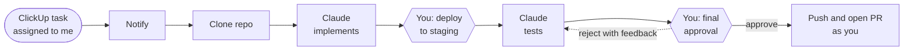

# Auto Worker

A self-hosted, containerised application that lets Claude Code work on tasks
on its own, inside a sandbox, while you stay in control of the steps that
matter.

A typical workflow: a ClickUp task is assigned to you, Auto Worker picks it
up, notifies you, clones the repository and hands the task to Claude. Claude
implements it, the run pauses so you can deploy to staging, Claude tests, and
after your final approval the branch is pushed and a pull request is opened in
your name.



## What it does

- **Workflows as blocks.** Build them in the web UI or write them as YAML. Both are the same data.
- **Formulas.** Export a workflow with everything it needs (runtimes, MCP servers, Claude memory and skills, service containers, network allow list, environment variables, mounts, notification webhooks) and import it again after a redeploy.
- **Versions with rollback.** Every save is a version. Compare any two, restore an old one (as a new version, so nothing is lost), and carry the history inside the formula.
- **Triggers.** ClickUp task assigned to you (poll or webhook) and generic webhook. A workflow can have several, and "Run now" always works.
- **Human in the loop.** Approval blocks pause a run. Reject with a comment and Claude reworks it.
- **Edit while it runs.** Apply a saved workflow to runs that already started: finished blocks keep their results, the rest use the new blocks.
- **Full visibility.** Every run has a live log: trigger, Claude messages and tool calls, commands, test results, notifications, approvals.
- **A shell next to Claude.** Open a terminal in the run's workspace, as the same user Claude runs as.
- **Sandboxed.** Claude runs as an unprivileged user in a hardened container, only sees the secrets a workflow exposes to it, and can only connect to hosts on the workflow's allow list.

## Documentation

| Document | Content |
|----------|---------|
| [docs/SPEC.md](docs/SPEC.md) | Requirements, concepts and milestones |
| [docs/ARCHITECTURE.md](docs/ARCHITECTURE.md) | Components, run life cycle, data model, with diagrams |
| [docs/UI.md](docs/UI.md) | The web UI: pages, editor, run view, with screenshots |
| [docs/FORMULA.md](docs/FORMULA.md) | Formula reference: triggers, environment, notifications, blocks, templates |
| [docs/VERSIONING.md](docs/VERSIONING.md) | Workflow versions: history, diff, rollback, history in formulas |
| [docs/CLEANUP.md](docs/CLEANUP.md) | Deleting the files of finished runs, automatically or by hand |
| [docs/EXPRESSIONS.md](docs/EXPRESSIONS.md) | Conditions: skipping blocks, if/else, and the expression language |
| [docs/PAUSE_BEFORE.md](docs/PAUSE_BEFORE.md) | Pausing before a block, and editing Claude's prompt on a running run |
| [docs/DEPLOYMENT.md](docs/DEPLOYMENT.md) | Running it with Docker, first workflow, volumes, updating, CI/CD |
| [docs/SECURITY.md](docs/SECURITY.md) | How the sandbox works, what is verified on every build, known limits |
| [docs/CAPABILITIES.md](docs/CAPABILITIES.md) | What an agent needs for a real task and where each need is covered |
| [docs/DEVELOPMENT.md](docs/DEVELOPMENT.md) | Local setup, configuration, tests, adding blocks and triggers, API overview |

## Quick start

```bash
cp .env.example .env      # fill in the three secrets
docker compose up -d
```

Open http://localhost:8080, sign in with the token, and import
`examples/clickup-to-pr.formula.yaml` on the Workflows page to see a complete
workflow as blocks. `examples/task-to-pull-requests.formula.yaml` goes further:
features and bug fixes across a backend and a frontend repository, with a
plan review, fix loops, staging verification and a pull request per repository.
`examples/act-on-comments.formula.yaml` follows up on a task's review comments on the
branches that already exist, and replies on the task. [docs/DEPLOYMENT.md](docs/DEPLOYMENT.md) has the details.

To run it without Docker for development, see
[docs/DEVELOPMENT.md](docs/DEVELOPMENT.md). Outside the container there is no
sandbox.

## Status

The project is built in milestones, see [docs/SPEC.md](docs/SPEC.md#milestones).
