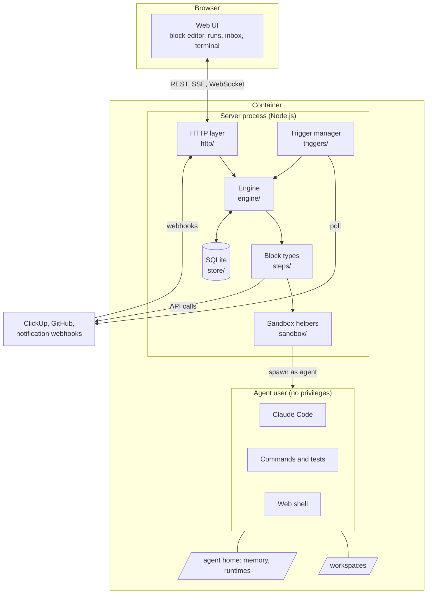
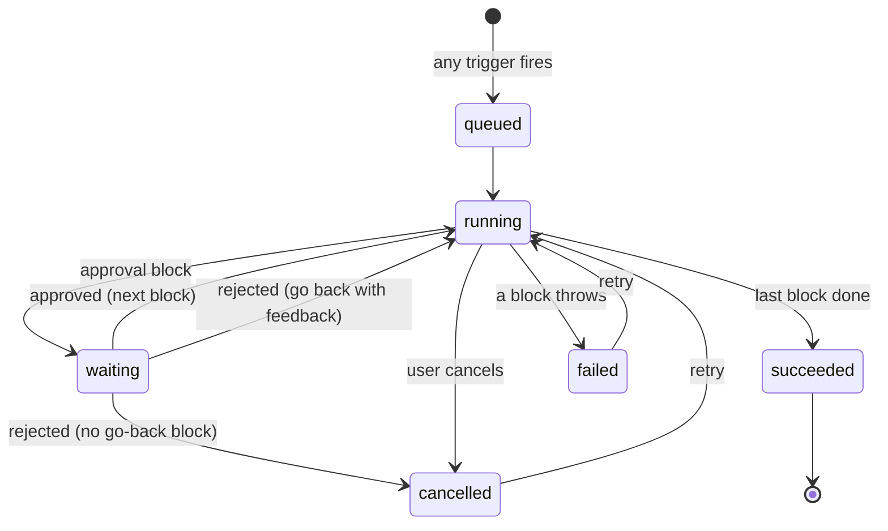
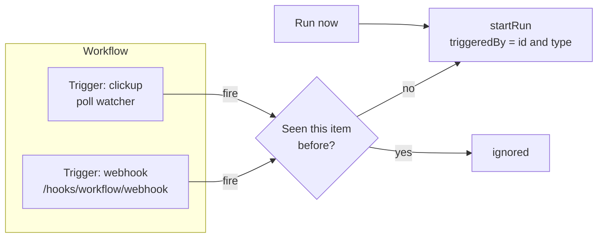
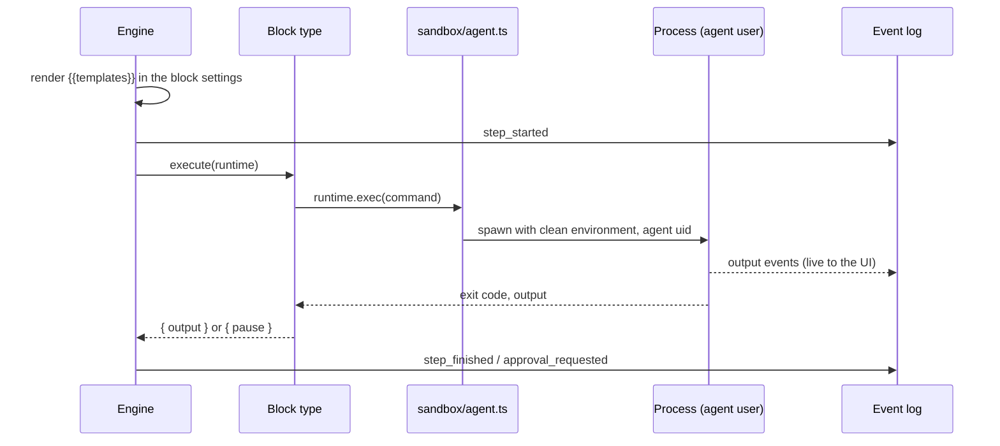
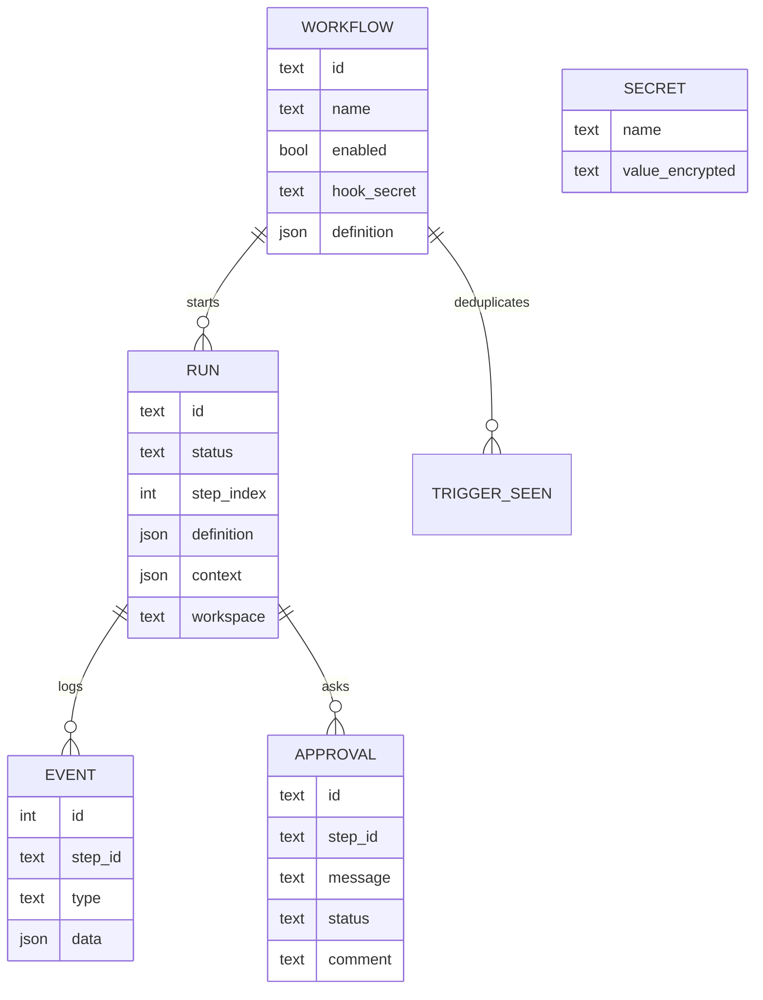
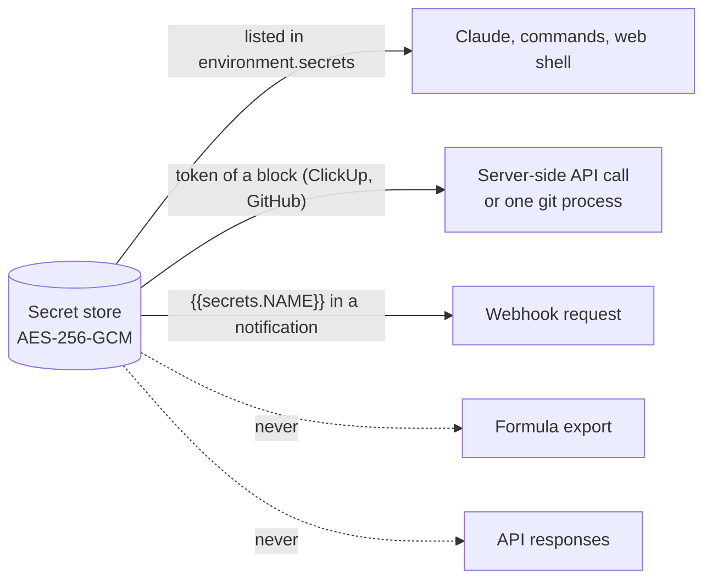

# Architecture

One Node.js process serves the web UI and the API, watches triggers and runs
workflows. Claude Code, workflow commands and the web shell are child
processes that run as a separate, unprivileged user.

## Components

## Source layout

| Path | Responsibility |
|------|----------------|
| `server/src/main.ts` | Startup: recover runs, import formula files, start triggers, listen |
| `server/src/config.ts` | The only place that reads environment variables |
| `server/src/types.ts` | Domain types shared by every module |
| `server/src/db.ts`, `store/` | SQLite schema and one small module per table group |
| `server/src/formula.ts` | Validation of workflow definitions, YAML import and export |
| `server/src/template.ts` | `{{ value }}` templating |
| `server/src/engine/engine.ts` | The run state machine |
| `server/src/steps/` | One file per block type, registered in `steps/index.ts` |
| `server/src/triggers/` | One file per trigger type, plus the manager in `triggers/index.ts` |
| `server/src/sandbox/` | Running processes as the agent user, preparing runtimes, memory and MCP config |
| `server/src/notify.ts` | Notification webhooks |
| `server/src/egress.ts` | The egress allow list (what is on it, what was blocked) |
| `server/src/gateway/` | The gateway container: UI relay and allow-list proxy. Shares no state with the server |
| `server/src/http/` | Server setup, authentication, JSON API, web shell |
| `server/test/` | Tests. External services are replaced by local stand-ins |
| `web/src/` | The React web UI, see [UI.md](UI.md) |

Block types and trigger types describe their own settings (`fields`). The UI
asks the API for this catalogue (`GET /api/meta`) and renders the forms from
it, so a new block needs no UI change.

## Life of a run

A workflow can have several triggers. The trigger manager keeps one watcher
per trigger and every trigger has its own webhook URL. Whichever fires first
starts the run, and the run records it as `triggeredBy`.

`run.stepIndex` always points at the block that is running, waiting or that
failed. Resuming after an approval and retrying after a failure are therefore
the same operation: continue from `stepIndex`.

A run keeps a copy of the workflow definition it started with, so editing a
workflow never changes runs that are in flight.

If the server restarts, runs that were executing are marked as failed with a
note, and can be retried from the block they were in. Runs waiting for
approval simply keep waiting.

## How a block executes

What a block returns decides what happens next:

- `{ output }`: stored as `steps.<id>.output` for later templates, then the next block runs.
- `{ pause: { message } }`: an approval is created and the run waits.
- throwing an error: the run fails at this block.

## Data model

## Where things live on disk

| Location (container) | Owner | Content |
|----------------------|-------|---------|
| `/data` | server | Database with workflows, runs and encrypted secrets. The agent user cannot read it |
| `/workspaces/<run id>` | agent | Working directory of a run, including the cloned repository |
| `/home/agent/workflows/<workflow id>/claude` | agent | Claude config directory of a workflow: `CLAUDE.md`, memory, sessions |
| `/home/agent/workflows/<workflow id>/mcp.json` | agent | MCP servers from the formula |
| `/home/agent/.local/share/mise` | agent | Installed language runtimes |

## Secrets and who sees them

Claude only receives the secrets a workflow lists under
`environment.secrets`. The GitHub token used for pushing is not in that list
in the example workflow, so Claude can commit but cannot push. Pushing happens
in the pull request block, after the approval block before it.
