# Architecture

One Node.js process serves the web UI and the API, watches triggers and runs
workflows. Claude Code, workflow commands and the web shell are child
processes that run as a separate, unprivileged user.

## Components

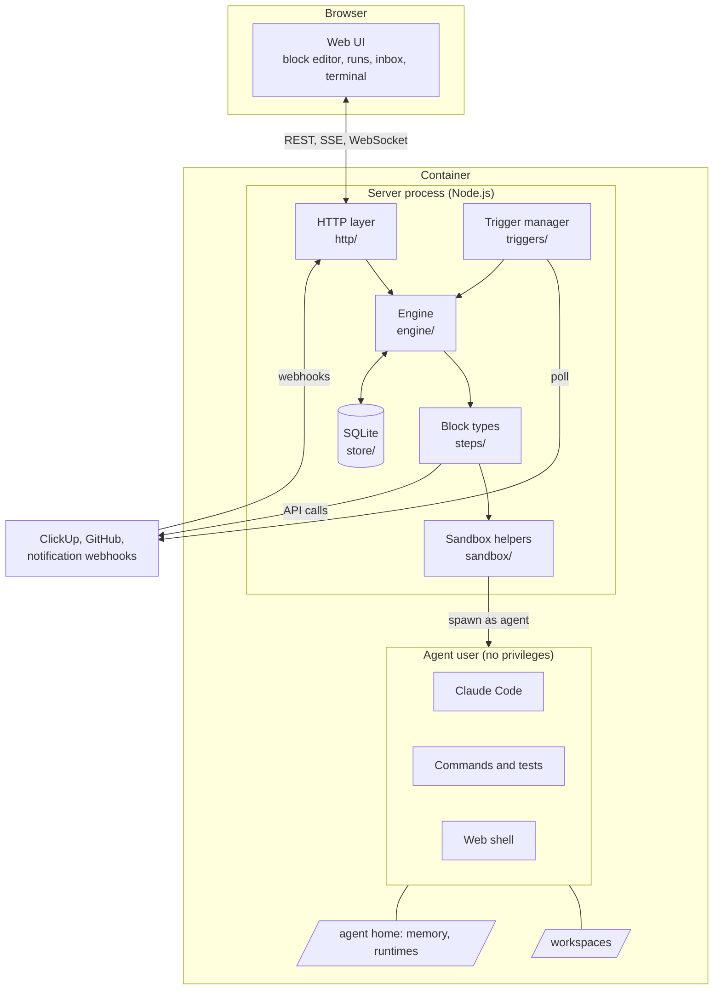

## Source layout

| Path | Responsibility |
|------|----------------|
| `server/src/main.ts` | Startup: recover runs, import formula files, start triggers, listen |
| `server/src/config.ts` | The only place that reads environment variables |
| `server/src/types.ts` | Domain types shared by every module |
| `server/src/db.ts`, `store/` | SQLite schema and one small module per table group |
| `server/src/formula.ts` | Validation of workflow definitions, YAML import and export |
| `server/src/inputs.ts` | Inputs of a manual run: checks the declarations and the values "Run now" sends |
| `server/src/template.ts` | `{{ value }}` templating |
| `server/src/expression.ts` | The expression language of conditions: parser and interpreter, no `eval`. See [EXPRESSIONS.md](EXPRESSIONS.md) |
| `server/src/engine/engine.ts` | The run state machine |
| `server/src/engine/apply-definition.ts` | What switching a run to an edited workflow changes, and where it continues |
| `server/src/steps/` | One file per block type, registered in `steps/index.ts` |
| `server/src/triggers/` | One file per trigger type, plus the manager in `triggers/index.ts` |
| `server/src/sandbox/` | Running processes as the agent user, preparing runtimes, memory and MCP config |
| `server/src/notify.ts` | Notification webhooks |
| `server/src/egress.ts` | The egress allow list (what is on it, what was blocked) |
| `server/src/gateway/` | The gateway container: UI relay and allow-list proxy. Shares no state with the server |
| `server/src/http/` | Server setup, authentication, JSON API, web shell |
| `server/test/` | Tests. External services are replaced by local stand-ins |
| `web/src/` | The React web UI, see [UI.md](UI.md) |

Block types and trigger types describe their own settings (`fields`). The UI
asks the API for this catalogue (`GET /api/meta`) and renders the forms from
it, so a new block needs no UI change.

## Life of a run

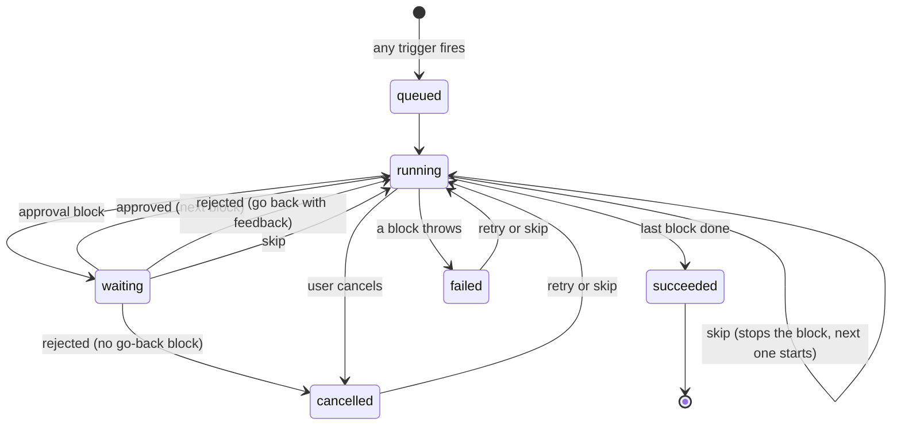

A workflow can have several triggers. The trigger manager keeps one watcher
per trigger and every trigger has its own webhook URL. Whichever fires first
starts the run, and the run records it as `triggeredBy`.

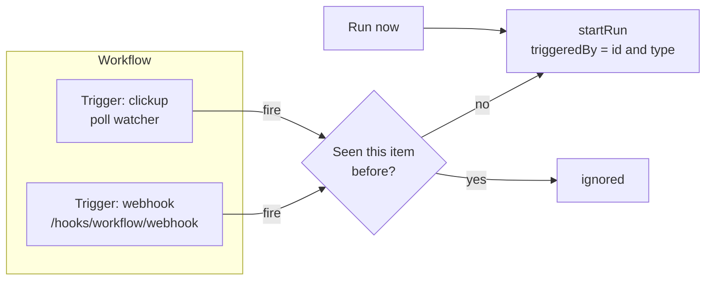

Blocks run in list order, with two exceptions that both come from conditions
(see [EXPRESSIONS.md](EXPRESSIONS.md)):

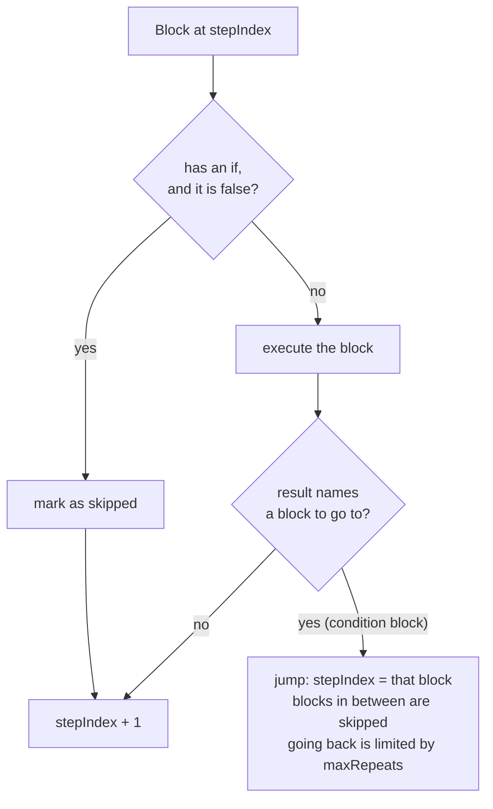

`run.stepIndex` always points at the block that is running, waiting or that
failed. Resuming after an approval and retrying after a failure are therefore
the same operation: continue from `stepIndex`. A retry also sets the
`maxRepeats` counters of the condition blocks back to zero, so a run that
failed because it had gone back too often can go back again.

A run keeps a copy of the workflow definition it started with, so editing a
workflow never changes runs that are in flight, unless you apply the edits to
them (next section).

### Applying workflow edits to existing runs

After a workflow is saved, a run that has not succeeded can switch to the new
definition: **Apply latest workflow** on the run page, or **Apply to them** in
the editor right after saving, for every open run at once. The rules live in
`server/src/engine/apply-definition.ts` (a pure function, so the UI can show
the plan before anything changes) and `applyDefinition` in the engine.

- Blocks are matched by **id**.
- Blocks the run already passed **keep their results** and do not run again,
  even if they were changed. A block added before the run's position does not
  run in this run.
- The block the run is at, and every block after it, **come from the new
  definition**. If the block the run is at was removed, the run continues with
  the next block that still exists.
- Environment, notifications and the other sections apply too. A changed
  environment is prepared again before the next block.

What happens depends on the state of the run:

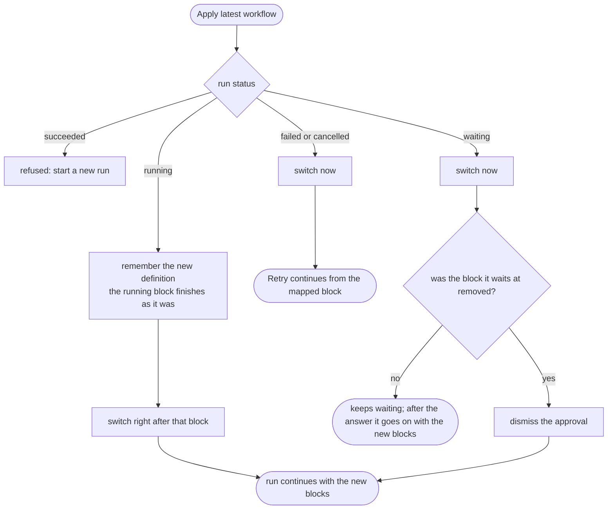

Where the run continues (`mapPosition`):

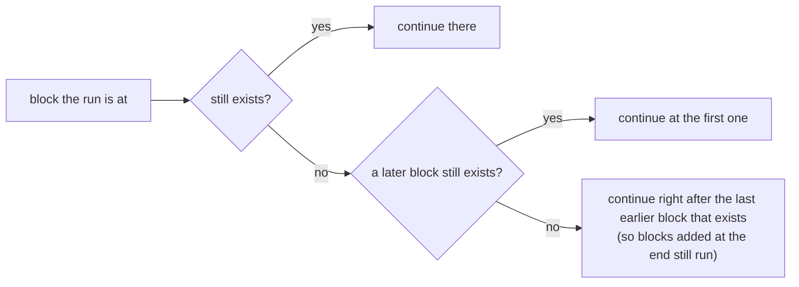

Every switch is recorded in the run's log as `definition_applied`, with the
blocks that changed and where the run continues. Retrying or skipping does not
switch a run on its own: a run keeps its definition until someone applies a
newer one.

### Skipping a block by hand

**Skip** on the run page passes over the block the run is at, for a block
that is stuck or that the run can do without. It works while the block is
running (its command or Claude session is stopped first), while it waits for
an approval (the approval is dismissed), and after it failed or the run was
cancelled. The block is recorded exactly like one skipped by a condition:
`output: null` and `skipped: true`, so a later block can ask
`steps.<id>.skipped`. Then the run continues with the next block.

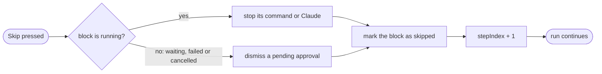

If the server restarts, runs that were executing are marked as failed with a
note, and can be retried from the block they were in. Runs waiting for
approval simply keep waiting.

## How a block executes

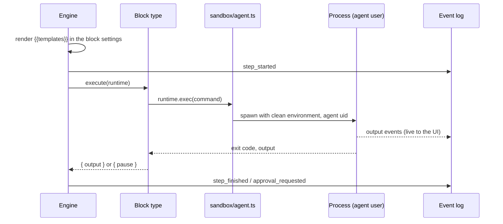

What a block returns decides what happens next:

- `{ output }`: stored as `steps.<id>.output` for later templates, then the next block runs.
- `{ pause: { message } }`: an approval is created and the run waits.
- throwing an error: the run fails at this block.

## Data model

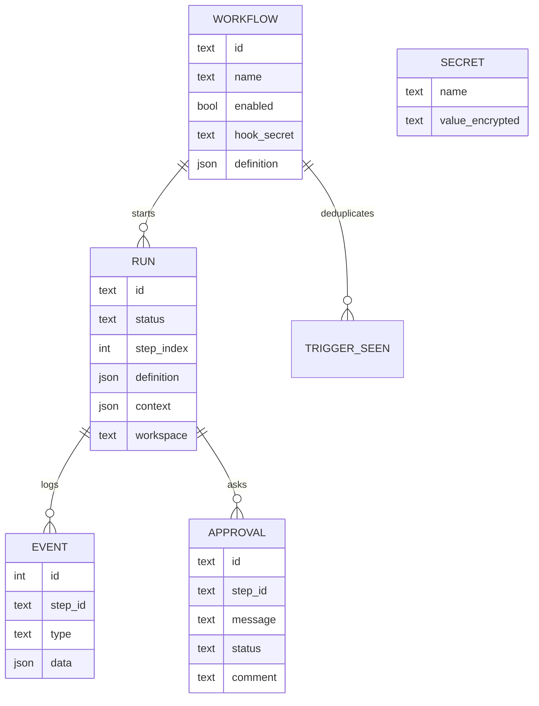

## Where things live on disk

| Location (container) | Owner | Content |
|----------------------|-------|---------|
| `/data` | server | Database with workflows, runs and encrypted secrets. The agent user cannot read it |
| `/workspaces/<run id>` | agent | Working directory of a run, including the cloned repository |
| `/home/agent/workflows/<workflow id>/claude` | agent | Claude config directory of a workflow: `CLAUDE.md`, memory, sessions |
| `/home/agent/workflows/<workflow id>/mcp.json` | agent | MCP servers from the formula |
| `/home/agent/workflows/<workflow id>/mise.toml` | agent | The runtimes of the formula, rewritten at the start of every run |
| `/home/agent/.local/share/mise` | agent | Installed language runtimes, shared by all workflows |

## How a workflow gets its runtime versions

The image ships Node.js 22. A formula can ask for something else under
`environment.runtimes`, for example `{ name: node, version: "20" }`. Three
parts make every process of that workflow use it:

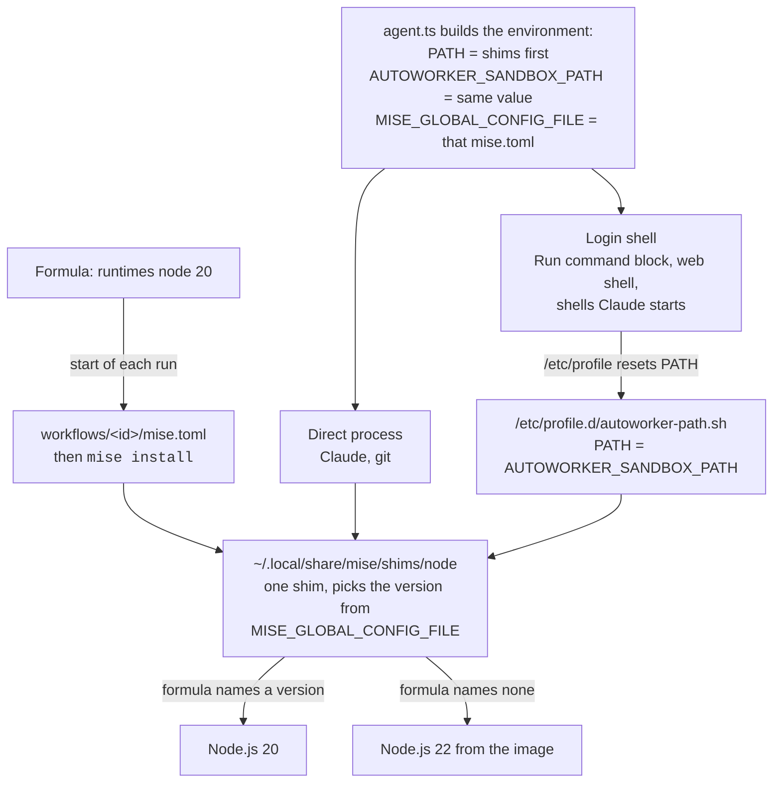

- **The shims come first on `PATH`.** `server/src/sandbox/agent.ts` is the one
  place that builds the environment of sandbox processes.
- **The shim reads the workflow's own `mise.toml`**, so two workflows can use
  different versions at the same time. A changed version applies to the next
  run. A run that is retried keeps the definition it started with, unless the
  newer workflow is applied to it.
- **Login shells get the `PATH` back.** Debian's `/etc/profile` replaces `PATH`
  with a fixed list, which would drop the shims and silently fall back to the
  image's Node.js. [`docker/profile.d/autoworker-path.sh`](../docker/profile.d/autoworker-path.sh)
  restores it from `AUTOWORKER_SANDBOX_PATH`. The smoke test checks this with
  a real download of Node.js 20.

Outside the container (`npm run dev`) that profile script is not installed, so
"Run command" blocks and the web shell use whatever your own login shell puts
on `PATH`.

## Secrets and who sees them

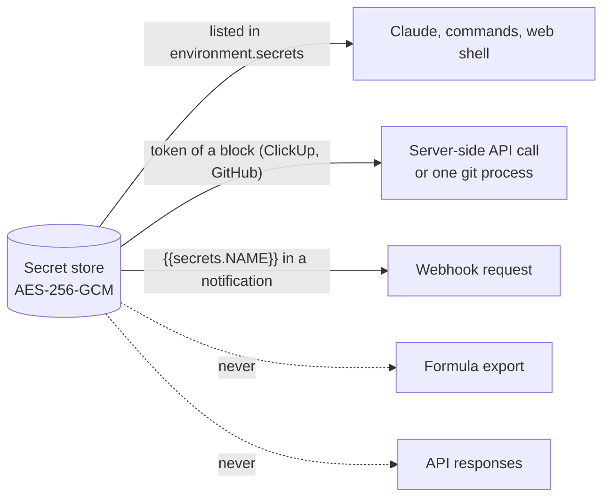

Claude only receives the secrets a workflow lists under
`environment.secrets`. The GitHub token used for pushing is not in that list
in the example workflow, so Claude can commit but cannot push. Pushing happens
in the pull request block, after the approval block before it.

### Commit author

Claude commits inside the sandbox long before the pull request block runs, so
the author of a commit is decided for the whole sandbox, not by one block.
`server/src/git-identity.ts` holds the rules:

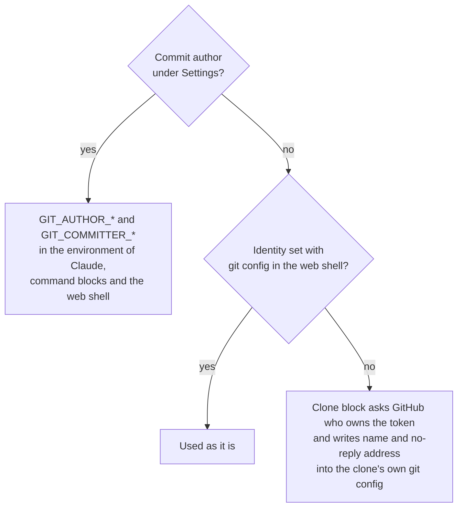

| Source | Where it lives | Wins over |
| --- | --- | --- |
| Commit author under Settings | Environment of every sandbox process (`baseEnv` in `sandbox/agent.ts`) | Everything below. A formula can still override the variables under `environment.env` |
| `git config --global` in the web shell | `/home/agent/.gitconfig` on the `agent-home` volume | The token owner |
| Owner of the GitHub token | `.git/config` of each clone, written by the clone block | Nothing: it only fills in what is missing |

A name without an email (or the other way round) under Settings is completed
from the next source. When none of the three gives an author, the clone block
says so in the run log. Only the name and the address are written to the
clone; the token itself never is.
