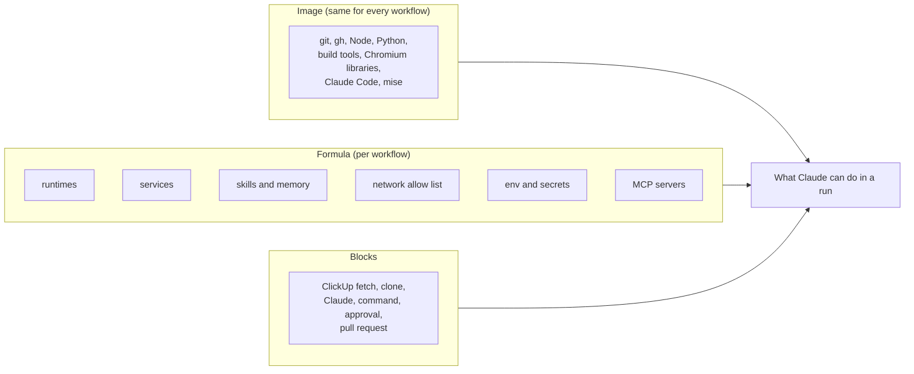

# What an agent needs, and where it comes from

This list was derived from two real agent runs (a backend task and the
matching frontend task). Each step they took maps to something the image, the
formula or a block provides.

| What the agents did | Needed | Provided by |
|---------------------|--------|-------------|
| Pulled the ClickUp task with comments and subtasks, downloaded attachments | ClickUp API access, files in the workspace | `clickup_fetch_task` block with `includeComments`, `includeSubtasks`, `downloadAttachments`. A ClickUp MCP server under `mcpServers` works too |
| Read the existing code, created a branch from `origin/main` | git, a clone | `git_clone` block. git and git worktrees are available in the sandbox |
| Looked at previous pull requests for naming, title style and labels | `gh` with read access | `gh` is in the image. Expose a read-only `GH_TOKEN` secret and allow `api.github.com` |
| Type-checked, linted, ran unit tests | Node, npm or yarn, the project's own tooling | Node 22 in the image, other versions through `runtimes` (for example `node` `24`). yarn and pnpm through corepack |
| Got Docker running, started `mongo-local`, ran the suites | A database for tests | `services` in the formula. The sandbox gets no Docker access; the database runs as a sibling container reachable as `mongo:27017` |
| Ran a dev server and a mocked Playwright end-to-end test | Chromium, free local ports | Chromium system libraries in the image; the browser itself is installed by the project's Playwright version. Dev servers listen on localhost inside the sandbox |
| Ran a real end-to-end test against staging after the backend was deployed | A pause for the deployment, network access to staging, staging credentials | `approval` block ("Deploy to staging"), the staging host in `network.allow`, credentials as exposed secrets |
| Used the `frontend-prompt` skill to write a handoff document | Claude Code skills that persist | `skills` in the formula, stored in the workflow's Claude config on the `agent-home` volume |
| Saved notes to memory for future sessions | Memory that survives runs and redeploys | Per-workflow Claude config directory on the `agent-home` volume, exported with the formula |
| Reviewed its own diff, committed only the feature files | git | In the sandbox. You can do the same in the web shell before approving |
| Pushed and opened the pull request following the repository conventions | A token that can push, used only after approval | `github_pr` block after an `approval` block. The token is not exposed to Claude |
| Downloaded packages and browsers | Outbound access to registries | `network.allow`, see [FORMULA.md](FORMULA.md#network) for typical hosts |

## Not covered yet

- **Starting arbitrary containers from inside a run.** By design there is no
  Docker inside the sandbox. Containers have to be declared as `services` and
  deployed with compose.
- **Claude asking a question in the middle of a block.** Today a pause is
  always an `approval` block between blocks.
- **Opening a dev server from your browser.** Ports inside the sandbox are
  not published. Use the web shell, or let Claude drive Playwright.
