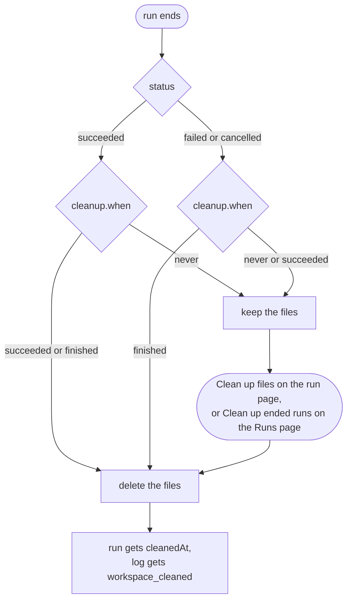
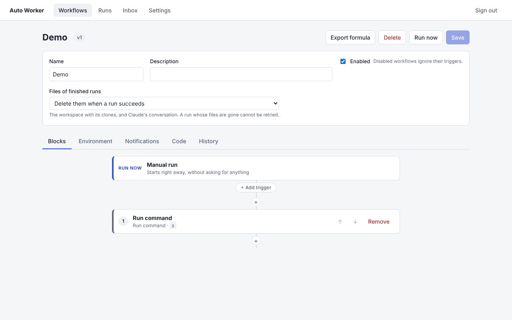

# Cleaning up run files

Every run works in its own folder, and Claude Code keeps a conversation for
every folder it worked in. Both stay on disk after the run ends, so you can
open the shell and look at the work, or retry a failed run. A cleanup deletes
them when they are no longer needed. The run itself, its log, its approvals and
its outputs stay in the history.

## What is deleted

| Location | What it holds |
|----------|---------------|
| `/workspaces/<run id>` | The run's workspace: every cloned repository, task attachments, build output, anything Claude or a command wrote there |
| `<claude config>/projects/<folder>` | Claude's conversation of the workspace and of every folder inside it, such as each cloned repository |
| `<claude config>/todos`, `file-history`, `session-env` | Files Claude Code names after the run's conversation (session id) |

`<claude config>` is the workflow's Claude config directory,
`/home/agent/workflows/<workflow id>/claude`. Everything else in it stays:
`CLAUDE.md`, memory, skills, MCP settings and the conversations of other runs.

The server never deletes anything outside the workspaces directory and the
workflow's Claude config directory, and it deletes as the agent user, which
owns all of these files. Folders a command made read-only (the Go module cache
does this) are made writable first, so they go too.

## When it happens



### Automatically

The workflow's `cleanup` setting decides. It is part of the formula, so it
travels with the workflow when you export and import it:

```yaml
cleanup:
  when: succeeded     # never (default) | succeeded | finished
```

| `when` | Deletes the files of |
|--------|----------------------|
| `never` | No run. Only a person cleans up. This is what formulas without `cleanup` get |
| `succeeded` | Runs that succeeded. Failed and cancelled runs keep their files, so you can look at them and retry |
| `finished` | Every run that ends: succeeded, failed or cancelled |

In the editor this is **Files of finished runs** at the top of the workflow.



A run waiting for your approval has not ended, so it keeps its files. If you
cancel it, it ends, and `finished` cleans it up.

### By hand

- **Clean up files** on the run page deletes the files of that run. It is
  there once the run has ended and its files are still on disk.
- **Clean up ended runs** on the Runs page does the same for every run that
  has ended and still has files.

A run that is queued, running or waiting cannot be cleaned up: cancel it first.

## After a cleanup

- The run records when it was cleaned (`cleanedAt`), and its log gets a
  `workspace_cleaned` entry that lists the deleted folders and whether the
  cleanup was automatic or by hand. A cleanup that fails logs
  `workspace_cleanup_failed` and can be started again.
- **Retry**, **Skip** and **Apply latest workflow** are refused: the run's
  blocks would continue in an empty folder. Start a new run instead.
- **Open shell** is gone from the run page.
- Pushed branches and opened pull requests are on GitHub and are not touched.

## API

| Call | Does |
|------|------|
| `POST /api/runs/:id/cleanup` | Cleans up one run that has ended. Answers with the run; `409` when it has not ended |
| `POST /api/runs/cleanup` | Cleans up every ended run that still has files. Body `{ "workflowId": "..." }` limits it to one workflow. Answers `{ "cleaned": <count> }` |

## Code

| File | Role |
|------|------|
| `server/src/engine/cleanup.ts` | Finds the run's files (`runFiles`), deletes them (`removeRunFiles`), and reads the setting (`cleansUpAutomatically`) |
| `server/src/engine/engine.ts` | `cleanUpRun`, `cleanUpEndedRuns`; `finish` starts the automatic cleanup; retry, skip and apply refuse cleaned runs |
| `server/src/store/runs.ts` | `markCleaned`, `listUncleanedFinishedRuns`; the `cleaned_at` column |
