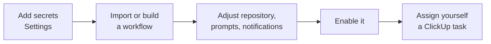
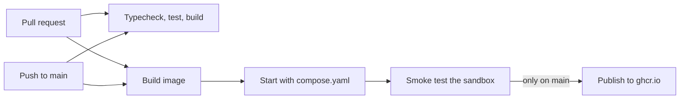

# Deployment

## Start

Requirements: Docker with the compose plugin.

```bash
git clone https://github.com/murilopereirame/automatic-system.git
cd automatic-system
cp .env.example .env
# set AUTOWORKER_TOKEN and AUTOWORKER_SECRET_KEY, e.g. with: openssl rand -hex 32
docker compose up -d
```

Open http://localhost:8080 and sign in with `AUTOWORKER_TOKEN`.

`docker compose up -d` pulls the published image. To build it from the
checkout instead, run `docker compose up -d --build`.

## First workflow



1. **Settings > Secrets**: add what the workflow needs.

   | Secret | Used for |
   |--------|----------|
   | `CLAUDE_CODE_OAUTH_TOKEN` | Claude Code login. Create it with `claude setup-token` on your machine. `ANTHROPIC_API_KEY` works too |
   | `GITHUB_TOKEN` | Clone, push and open pull requests as you. A fine-grained token with Contents and Pull requests read/write on the repositories involved |
   | `CLICKUP_TOKEN` | ClickUp trigger and blocks. A personal API token |

2. **Workflows > Import formula**: choose `examples/clickup-to-pr.formula.yaml`.
3. Open the workflow, set the repository in the "Clone the repository" block, review the prompts, and adjust the notification webhook.
4. On the **Environment** tab, check that only the Claude token is exposed to Claude.
5. Tick **Enabled** and save.

## What is stored where

| Volume | Mounted at | Content | Back up? |
|--------|-----------|---------|----------|
| `data` | `/data` | Workflows, run history, encrypted secrets | Yes |
| `agent-home` | `/home/agent` | Claude memory and skills per workflow, installed runtimes, package caches | Optional. Memory is also part of exported formulas |
| `workspaces` | `/workspaces` | One directory per run, with the cloned repository | No |
| `./formulas` | `/formulas` (read-only) | Formula files imported at every start | Keep in version control |

## Redeploying

A formula carries everything about a workflow except secret values. To move
to a new host or start from scratch:

1. Export each workflow (**Export formula**), or keep the files in `./formulas`.
2. Start the new deployment.
3. Put the files in `./formulas` (or import them in the UI) and add the secrets again.

Runtimes are installed again on the first run. Memory files are restored from the formula.

## Updating

```bash
docker compose pull && docker compose up -d
```

Runs that are executing during a restart are marked as failed and can be
retried from the block they were in. Runs waiting for approval keep waiting.

## Remote access

By default the port is bound to `127.0.0.1`. To reach the UI from elsewhere,
put a reverse proxy with TLS in front of it and set `AUTOWORKER_PUBLIC_URL` to
the external URL, so links in notifications work. The proxy must pass
WebSocket upgrades (for the shell) and must not buffer `/api/stream`.

For ClickUp in webhook mode and for webhook triggers, only `/hooks/` needs to
be reachable from the internet.

## Extra mounts

A formula can declare the mounts it expects. They are shown on the
Environment tab together with a compose snippet. Put that snippet into a
`compose.override.yaml` next to `compose.yaml`:

```yaml
services:
  autoworker:
    volumes:
      - ./shared-cache:/cache
```

## What the image contains

| Tool | Purpose |
|------|---------|
| Claude Code | The agent |
| git, git-lfs, gh, openssh-client | Version control, reading and creating pull requests |
| Node.js 22, npm, yarn and pnpm (corepack) | Default JavaScript runtime |
| mise | Installs the runtimes a formula asks for (other Node versions, Python, Go, ...) into the agent home |
| Python 3, build-essential, pkg-config | Native modules and scripts |
| System libraries for Chromium | Playwright end-to-end tests. Browsers themselves are downloaded by the project's Playwright version into the agent home (`npx playwright install chromium`) |
| jq, ripgrep, fd, curl, wget, zip/unzip | Everyday helpers |

Build arguments: `CLAUDE_CODE_VERSION` (default `latest`), `MISE_VERSION`
(default latest) and `INSTALL_BROWSER_DEPS` (default `true`).

Inside the sandbox, Chromium has to be started without its own sandbox
(`--no-sandbox`, or `chromiumSandbox: false` in Playwright), because the
container does not allow the kernel features it needs. The container is the
sandbox.

## CI/CD

`.github/workflows/ci.yml` runs on every pull request and on `main`:



To block merging on failures, mark both jobs as required status checks in the
branch protection rules of `main`.
