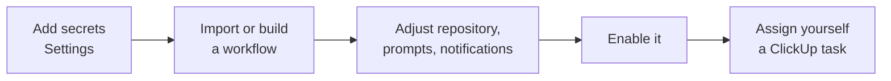
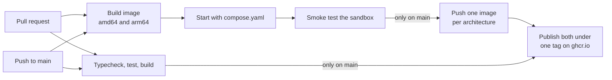

# Deployment

## Start

Requirements: Docker with the compose plugin.

```bash
git clone https://github.com/murilopereirame/automatic-system.git
cd automatic-system
cp .env.example .env
# set AUTOWORKER_TOKEN, AUTOWORKER_SECRET_KEY and AUTOWORKER_GATEWAY_SECRET,
# each to its own random value, e.g. from: openssl rand -hex 32
docker compose up -d
```

Open http://localhost:8080 and sign in with `AUTOWORKER_TOKEN`.

`docker compose up -d` pulls the published image. It is published for
`linux/amd64` and `linux/arm64` (Apple Silicon, Raspberry Pi, ARM servers), and
Docker picks the one that matches the host. To build it from the checkout
instead, run `docker compose up -d --build`.

This starts two containers: `autoworker` (the app and the sandbox, on an
internal network) and `gateway` (the web UI port and the allow-list proxy for
outbound connections). See [SECURITY.md](SECURITY.md) for why.

## First workflow



1. **Settings > Secrets**: add what the workflow needs.

   | Secret | Used for |
   |--------|----------|
   | `CLAUDE_CODE_OAUTH_TOKEN` | Claude Code login. Create it with `claude setup-token` on your machine. `ANTHROPIC_API_KEY` works too |
   | `GITHUB_TOKEN` | Clone, push and open pull requests as you. A fine-grained token with Contents and Pull requests read/write on the repositories involved |
   | `CLICKUP_TOKEN` | ClickUp trigger and blocks. A personal API token |

2. **Workflows > Import formula**: choose `examples/clickup-to-pr.formula.yaml`.
3. Open the workflow, set the repository in the "Clone the repository" block, review the prompts, and adjust the notification webhook.
4. On the **Environment** tab, check that only the Claude token is exposed to Claude, and that the **Network** list contains the hosts the work needs (GitHub, your package registry, your staging system).
5. Turn on **Enabled** and save.

## What is stored where

| Volume | Mounted at | Content | Back up? |
|--------|-----------|---------|----------|
| `data` | `/data` | Workflows, run history, encrypted secrets | Yes |
| `agent-home` | `/home/agent` | Claude memory and skills per workflow, installed runtimes, package caches | Optional. Memory is also part of exported formulas |
| `workspaces` | `/workspaces` | One directory per run, with the cloned repository | No |
| `outputs` | `/outputs` | One directory per run with the files it left for you ([OUTPUTS.md](OUTPUTS.md)) | If you need them |
| `./formulas` | `/formulas` (read-only) | Formula files imported at every start | Keep in version control |

### Output files on the host

Runs put files meant for you in `/outputs/<run id>` (see [OUTPUTS.md](OUTPUTS.md)),
and the run page downloads them. To have them land in a folder on the host
instead, swap the `outputs` volume for a bind mount of a dedicated, empty
folder that the agent user (uid 10001) owns:

```bash
mkdir outputs && sudo chown 10001:10001 outputs
```

```yaml
    volumes:
      - ./outputs:/outputs
```

The agent can write to everything in that folder, so never point it at a
folder that holds anything else.

## Redeploying

A formula carries everything about a workflow except secret values. To move
to a new host or start from scratch:

1. Export each workflow (**Export formula**), or keep the files in `./formulas`.
2. Start the new deployment.
3. Put the files in `./formulas` (or import them in the UI) and add the secrets again.

Runtimes are installed again on the first run. Memory files are restored from the formula.

## Updating

```bash
docker compose pull && docker compose up -d
```

Runs that are executing during a restart are marked as failed and can be
retried from the block they were in. Runs waiting for approval keep waiting.

## Remote access

By default the port is bound to `127.0.0.1`. To reach the UI from elsewhere,
put a reverse proxy with TLS in front of it and set `AUTOWORKER_PUBLIC_URL` to
the external URL, so links in notifications work. The proxy must pass
WebSocket upgrades (for the shell) and must not buffer `/api/stream`.

For ClickUp in webhook mode and for webhook triggers, only `/hooks/` needs to
be reachable from the internet.

To let `gh` read pull requests inside the sandbox, store a read-only token as
a secret named `GH_TOKEN` and expose it to Claude on the Environment tab.
Keep the token that can push (`GITHUB_TOKEN`) unexposed.

## Services and extra mounts

A formula can declare service containers (for example a database for tests)
and the mounts it expects. The Environment tab shows whether they are present
and generates the compose file for them. Save it as `compose.override.yaml`
next to `compose.yaml` and run `docker compose up -d`:

```yaml
services:
  autoworker:
    volumes:
      - ./shared-cache:/cache
  mongo:
    image: mongo:7
    restart: unless-stopped
    networks: [sandbox]
```

Services join the internal `sandbox` network. The sandbox reaches them by
name (`mongo:27017`); they have no internet access and are not published on
the host.

## Troubleshooting

| Symptom | Cause and fix |
|---------|---------------|
| `403` or "tunnel failed" from git, npm, curl | The host is not on the allow list. Settings > Sandbox lists refused hosts; add the one you need under Environment > Network |
| "Service not reachable: mongo:27017" | The service is declared in the formula but not deployed. Add the snippet from the Environment tab to `compose.override.yaml` |
| Playwright cannot download or open pages | Allow the browser download host (see Settings > Sandbox for what was refused) and your target host, pass the proxy to `chromium.launch`, and start Chromium with `chromiumSandbox: false` |
| A formula in `./formulas` is not imported | The file must be world-readable (`chmod 644`). Check `docker compose logs autoworker` |
| "Secret cannot be decrypted" | `AUTOWORKER_SECRET_KEY` changed. Restore the old value or enter the secrets again |

## What the image contains

| Tool | Purpose |
|------|---------|
| Claude Code | The agent |
| git, git-lfs, gh, openssh-client | Version control, reading and creating pull requests |
| Node.js 22, npm, yarn and pnpm (corepack) | Default JavaScript runtime |
| mise | Installs the runtimes a formula asks for (other Node versions, Python, Go, ...) into the agent home |
| Python 3, build-essential, pkg-config | Native modules and scripts |
| System libraries for Chromium | Playwright end-to-end tests. Browsers themselves are downloaded by the project's Playwright version into the agent home (`npx playwright install chromium`) |
| jq, ripgrep, fd, curl, wget, zip/unzip | Everyday helpers |

Build arguments: `CLAUDE_CODE_VERSION` (default `latest`), `MISE_VERSION`
(default latest) and `INSTALL_BROWSER_DEPS` (default `true`).

Inside the sandbox, Chromium has to be started without its own sandbox
(`--no-sandbox`, or `chromiumSandbox: false` in Playwright), because the
container does not allow the kernel features it needs. The container is the
sandbox.

## CI/CD

`.github/workflows/ci.yml` runs on every pull request and on `main`:



The image job runs twice, once on an amd64 runner and once on an arm64 runner,
so each image is built and smoke-tested on real hardware of its kind. On
`main`, the `publish` job joins the two images under `latest` and the commit
SHA, and only runs when the tests and both image jobs passed.

To block merging on failures, mark the test job and both image jobs as required
status checks in the branch protection rules of `main`.
