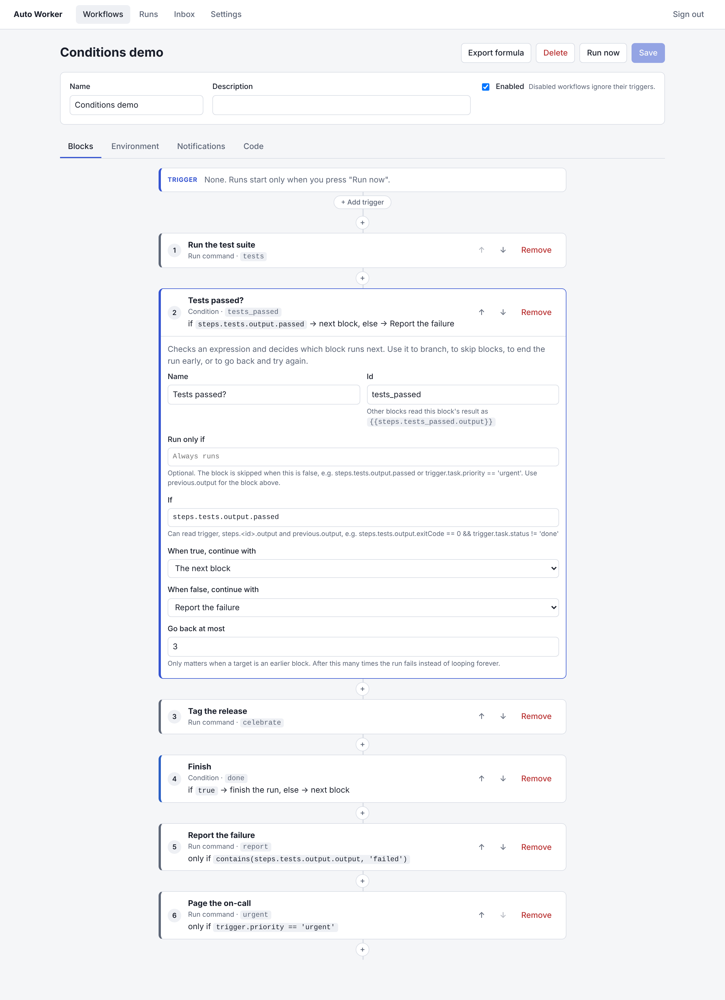
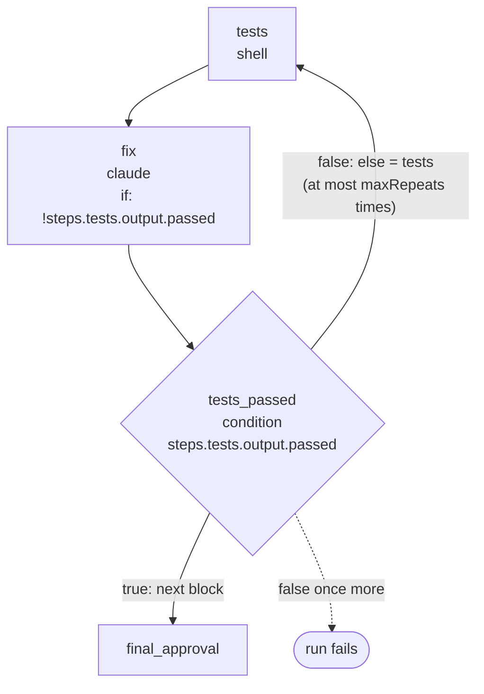
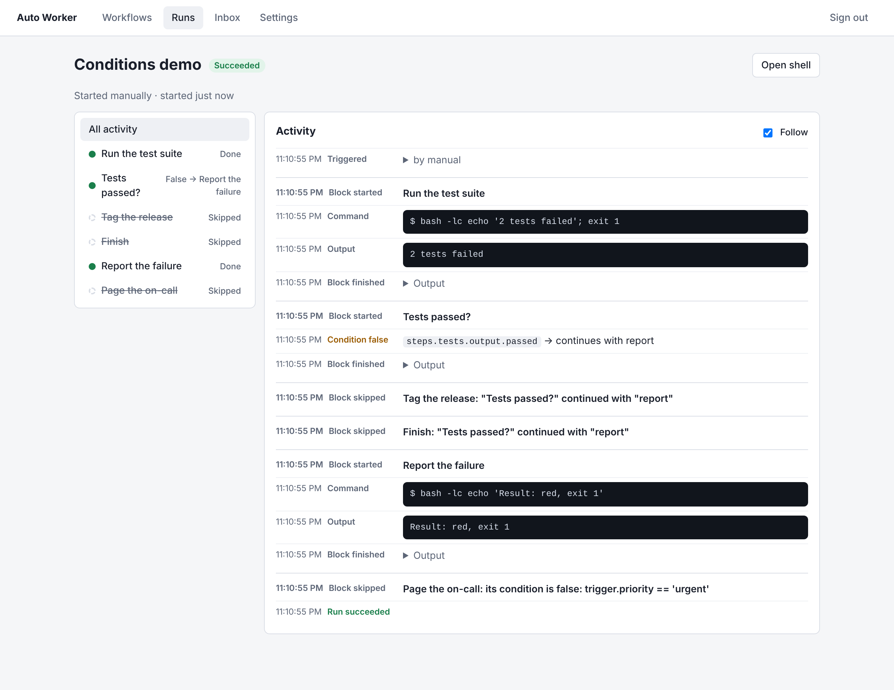
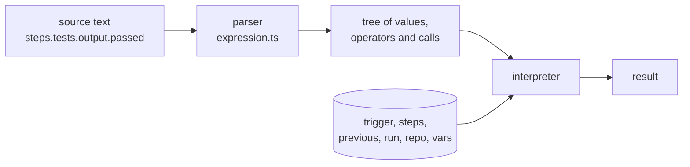

# Conditions and expressions

A workflow does not have to run every block every time. Conditions decide
what runs, based on what the trigger sent and on what earlier blocks produced.

There are three places to use them:

| Where | What it does |
|-------|--------------|
| **Run only if** on any block (`if:` in a formula) | Skips the block when the expression is false |
| The **Condition** block (`type: condition`) | An if/else: decides which block runs next |
| `{{= ... }}` in any text setting | Puts the result of an expression into a prompt, command or message |

All three use the same expression language, described below.



## Run only if

```yaml
steps:
  - id: tests
    type: shell
    with: { command: npm test, continueOnError: true }

  - id: fix
    type: claude
    if: "!steps.tests.output.passed"        # only when the tests failed
    with:
      prompt: "The tests failed, fix them:\n{{steps.tests.output.output}}"
```

A skipped block has no output: `steps.fix.output` is empty and
`steps.fix.skipped` is true. The run report shows it as **Skipped**, with the
expression that was false.

## The condition block

```yaml
  - id: tests_passed
    type: condition
    with:
      expression: steps.tests.output.passed
      then: pull_request     # block id, "$end", or leave out for the next block
      else: fix
      maxRepeats: 3          # only used when a target is an earlier block
```

| Setting | Meaning |
|---------|---------|
| `expression` | What is checked |
| `then` | Where the run continues when it is true |
| `else` | Where the run continues when it is false |
| `maxRepeats` | How often this block may send the run back to an earlier block. Default 3 |

A target is the id of any other block, or `$end` to finish the run
successfully. Without a target the run goes on with the next block. Blocks
that are jumped over count as skipped.

The block's own output is `result` (true or false), `branch` (`then` or
`else`) and `goTo`, so later blocks can also ask
`steps.tests_passed.output.result`.



Going back is how a workflow retries: here the tests run again after Claude's
fix, and on the second pass `fix` is skipped because the tests are green. To
keep a condition that never becomes true from looping forever, each condition
block may go back only `maxRepeats` times. After that the run fails.

**Retry** on such a run starts the count again from zero: the condition is
checked once more, and if it is still false the run goes back as before, up
to `maxRepeats` more times. This holds for every retry, whatever block the
run stopped at.

## What an expression can read

| Name | Value |
|------|-------|
| `trigger` | The payload of the trigger that started the run, e.g. `trigger.task.name` |
| `triggeredBy` | `triggeredBy.id` and `triggeredBy.type` of that trigger |
| `steps` | Results of earlier blocks: `steps.<id>.output...` and `steps.<id>.skipped` |
| `previous` | The block directly above this one: `previous.output...`, `previous.skipped` |
| `run` | `run.id` |
| `repo` | `repo.branch`, `repo.baseBranch`, `repo.owner`, `repo.name`, once a clone block ran |
| `repos` | Every clone by its folder: `repos.frontend.branch`, `repos.backend.baseBranch`, ... |
| `vars` | Values added to the run from the run page, e.g. `vars.staging.url` (see [RUN-VALUES.md](RUN-VALUES.md)) |

What a block puts in its output is listed in the block table of
[FORMULA.md](FORMULA.md#blocks). A value that does not exist is `null`, not an
error. A name that is not in this table is an error, and so is a block id with
a hyphen written as `steps.my-step` (it reads as "my minus step"). Write
`steps["my-step"]` instead.

## The language

| Kind | Syntax |
|------|--------|
| Values | `42`, `4.5`, `'text'`, `"text"`, `true`, `false`, `null`, `[1, 2, 3]` |
| Reading | `steps.tests.output.exitCode`, `trigger.task.tags[0]`, `steps["my-step"].output` |
| Compare | `==`, `!=`, `<`, `<=`, `>`, `>=` |
| Combine | `&&` (and), `\|\|` (or), `!` (not), parentheses |
| Calculate | `+`, `-`, `*`, `/`, `%`. `+` joins text when a side is not a number |
| Choose | `condition ? valueIfTrue : valueIfFalse` |

Rules worth knowing:

- **True and false.** `false`, `null`, `0` and empty text count as false,
  everything else as true. So `steps.tests.output.passed` on its own is a
  complete condition.
- **Numbers in text.** Command output and payloads are often text, so text
  that holds a number compares as that number: `'10' > '9'` is true.
- **Missing values.** `<`, `>` and friends are false when a side is missing.
  `a || b` gives `a` unless it is false, which makes `trigger.branch || 'main'`
  a default.

### Functions

| Function | Result |
|----------|--------|
| `contains(value, part)` | True when a text contains `part`, or a list has it as an item |
| `startsWith(text, start)`, `endsWith(text, end)` | True when the text begins or ends that way |
| `lower(text)`, `upper(text)`, `trim(text)` | The text in lower case, upper case, or without surrounding spaces |
| `length(value)` | Characters of a text, items of a list, keys of an object |
| `isEmpty(value)` | True for a missing value, blank text, an empty list or object |
| `coalesce(a, b, ...)` | The first value that is not empty |
| `number(value)`, `string(value)` | Conversion. `number` gives `null` for text that is not a number |
| `round(number)`, `min(a, b, ...)`, `max(a, b, ...)` | Arithmetic helpers. `min` and `max` also take a list |

### Examples

```text
trigger.task.priority == 'urgent'
steps.tests.output.exitCode == 0 && !contains(steps.tests.output.output, 'WARN')
contains(lower(trigger.task.name), 'hotfix') || contains(trigger.task.tags, 'bug')
length(steps.task.output.subtasks) > 0
previous.output.decision == 'approved'
```

In a template:

```yaml
with:
  branch: "{{= contains(lower(trigger.task.name), 'hotfix') ? 'main' : 'develop' }}"
  message: "Tests {{= steps.tests.output.passed ? 'passed' : 'failed with exit code ' + steps.tests.output.exitCode }}"
```

Filters work as in other placeholders: `{{= trigger.task.name || 'untitled' | json }}`.

## In the run report



- A condition block shows its outcome and where the run went, e.g. **False → Report the failure**.
- Skipped blocks are struck through and marked **Skipped**. The activity log says why: the expression that was false, or the condition block that jumped over them.

## How it is evaluated

Expressions are checked when a workflow is saved or a formula is imported, so
a typo shows up in the editor and not in the middle of a run.



The text is parsed into a tree, and a small interpreter in
`server/src/expression.ts` walks that tree. It is never passed to JavaScript's
`eval` or `Function`. An expression can read the values in the table above and
call the functions listed here, and nothing else: there is no assignment, no
loop, no access to inherited properties such as `constructor`, and no regular
expressions. Expressions are limited to 2000 characters. Text from a trigger
payload is only ever data for an expression, never part of one.
