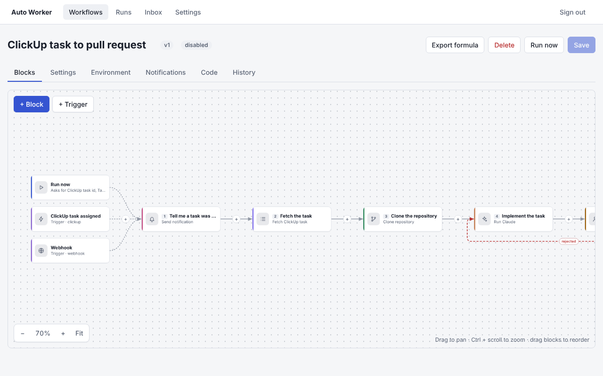
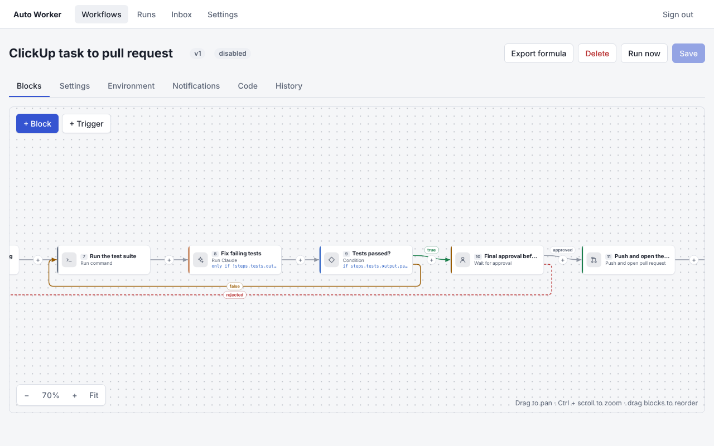
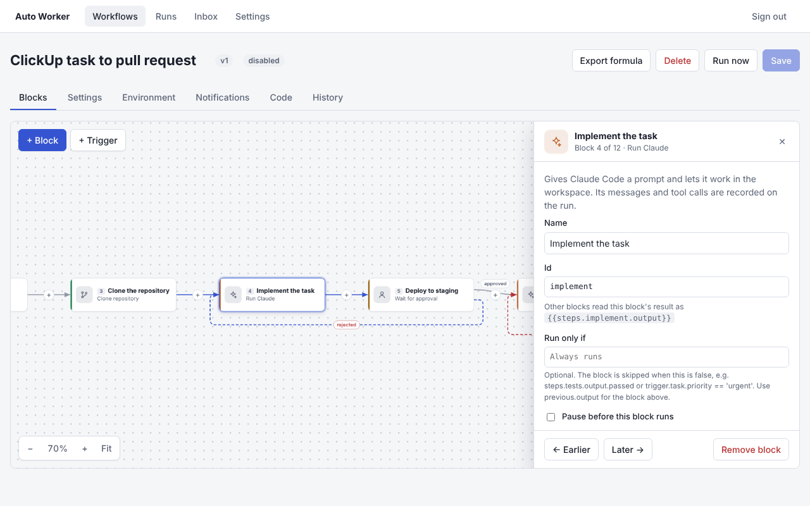
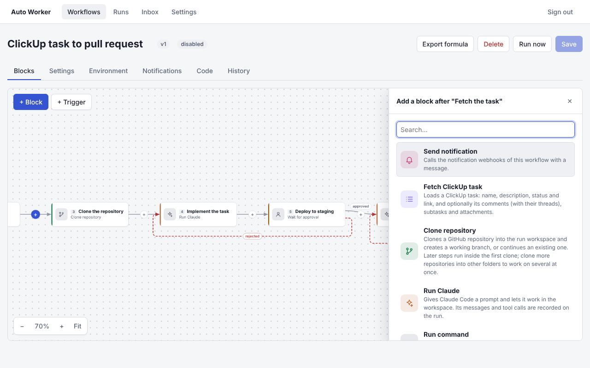
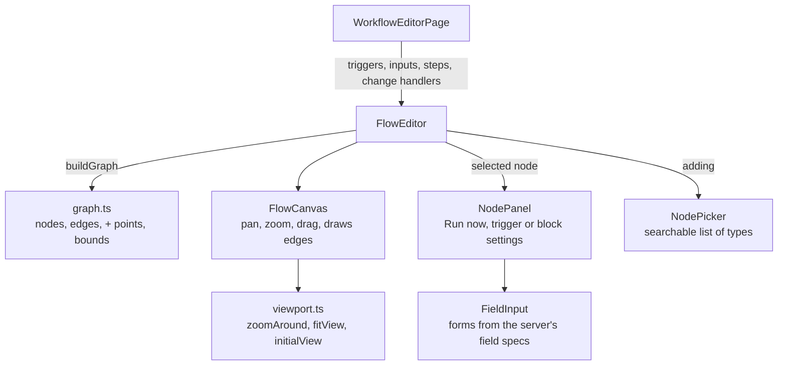

# Flow editor

The **Blocks** tab of the workflow editor shows a workflow as a flow of nodes
on a canvas, read from left to right. It edits the same formula as the other
tabs: nothing about the canvas (zoom, position) is saved.

## What is on the canvas

| Node | Where | What it is |
|------|-------|------------|
| **Run now** | First column, on top | Always there. Its panel edits the inputs a manual run asks for |
| Triggers | First column, below **Run now** | Any of them starts a run |
| Blocks | One line, in the order they run | Numbered; the icon and colour say the type |
| **End** | After the last block | Clicking it adds a block at the end |

A workflow without blocks shows a dashed **Add the first block** card instead
of the end.

Edges show where a run goes next:

| Edge | Meaning |
|------|---------|
| Dotted grey | From **Run now** or a trigger into the first block |
| Grey | On to the next block |
| Green `true` / amber `false` | Outcomes of a **Condition** block (`then` / `else`) |
| `true · false` | Both outcomes of a condition continue at the same place |
| `approved` / red dashed `rejected` | An **Approval** block that goes back to an earlier block when rejected (`onReject`) |
| Faint dotted | The next block in the order, which a condition never goes to directly |

Blocks always stay on one line in the order they run. Jumps to a block that is
not the next one are drawn around that line: forward `true` jumps above, every
other jump below, each in its own lane so overlapping jumps do not cover each
other.

## Working with it

| To | Do |
|----|-----|
| Pan | Drag the background, scroll, or drag with one finger |
| Zoom | Ctrl/⌘ + scroll, pinch, or the `−` / `+` buttons. The percentage resets to 100 % |
| See everything | **Fit** |
| Edit a node | Click it (or Tab to it and press Enter). The side panel opens |
| Add a block | `+` between two nodes, **+ Block** (adds at the end), or click **End** |
| Add a trigger | **+ Trigger** |
| Reorder | Drag a block sideways; the others slide to make room. Or **← Earlier** / **Later →** in its panel |
| Remove | `✕` on the node when hovering, **Remove** in its panel, or Delete/Backspace on the selected block |
| Close the panel | `✕`, Escape, or click the empty canvas |

The add panel lists the types the server offers (`GET /api/meta`) and filters
as you type; arrow keys and Enter pick one.

Changing a block's id in its panel also updates the conditions and approvals
that point to it, so jumps keep working.

A workflow opens fitted to the canvas when it is still readable that way
(70 % or more); a long one opens at its start instead, and **Fit** shows all of it.

## How it is built

| File | Does |
|------|------|
| `web/src/flow/graph.ts` | Pure layout: node positions, edge paths (with lanes for jumps), insert points, bounds, where a dragged block lands |
| `web/src/flow/viewport.ts` | Pure pan/zoom math |
| `web/src/flow/FlowCanvas.tsx` | Pointer, wheel and pinch handling, drawing, drag to reorder, toolbar and zoom controls, the sliding side panel |
| `web/src/flow/FlowEditor.tsx` | The editing: add, change, move, remove blocks and triggers; what each node shows |
| `web/src/flow/NodePanel.tsx` | Side panels for **Run now**, a trigger and a block |
| `web/src/flow/NodePicker.tsx` | The add panel |
| `web/src/flow/node-style.tsx` | Icon and colour per type; unknown types get a neutral square |

`graph.ts` and `viewport.ts` have no React in them and are covered by
`web/test/flow-graph.test.ts`. A new block type needs no change here; give it
an icon and colour in `node-style.tsx` if the neutral one does not fit.
