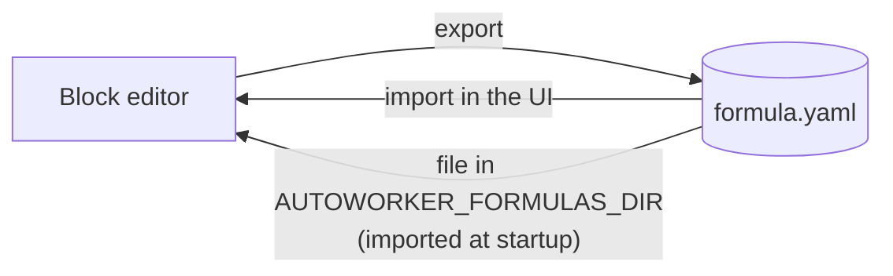
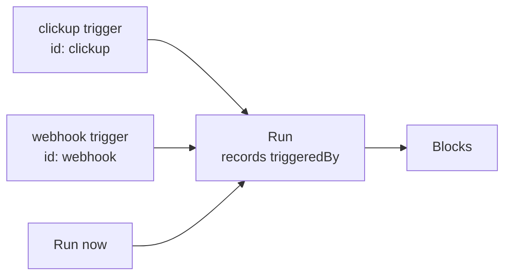
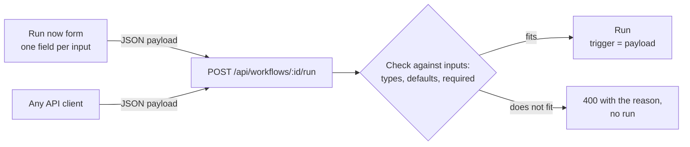
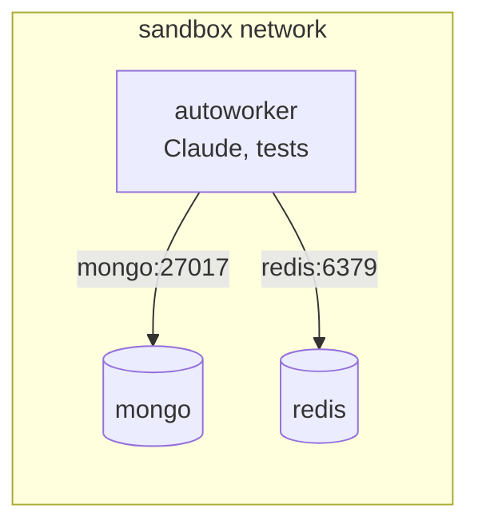
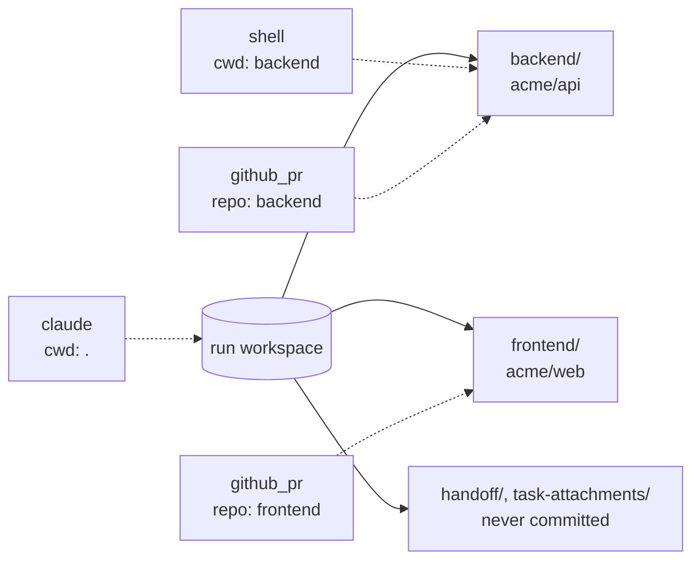
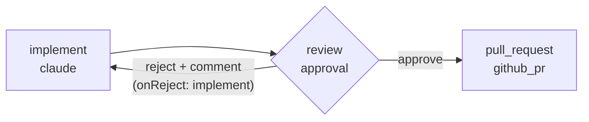

# Formula reference

A formula is the portable form of a workflow: one YAML file that contains
everything needed to recreate it on a fresh deployment. The web editor and the
formula are two views of the same data. Import a formula and it appears as
blocks; build blocks and export them as a formula.



Importing a formula whose name already exists updates that workflow.

Complete examples:

- [`examples/clickup-to-pr.formula.yaml`](../examples/clickup-to-pr.formula.yaml): one repository, from a ClickUp task to a pull request.
- [`examples/task-to-pull-requests.formula.yaml`](../examples/task-to-pull-requests.formula.yaml): features and bug fixes across a backend and a frontend repository. See [Several repositories](#several-repositories).
- [`examples/act-on-comments.formula.yaml`](../examples/act-on-comments.formula.yaml): follow-up on review comments. Reads the recent comments on a task, fixes what they ask for on the task's existing branches, and replies on the task. See [Following up on a branch](#following-up-on-a-branch).

## Structure

```yaml
apiVersion: autoworker/v1
kind: Formula
metadata:
  name: My workflow          # required, identifies the workflow on import
  description: What it does
  enabled: true              # disabled workflows ignore their triggers
  version: 3                 # written on export, ignored on import

triggers:                    # what starts a run: any one of these
  - id: clickup              # optional, defaults to the type
    type: clickup
    with: { mode: poll }
  - id: webhook
    type: webhook

inputs:                      # what "Run now" asks for, optional
  - { name: task.id, label: ClickUp task id, required: true }

environment:                 # what the workflow needs around it
  runtimes: [{ name: node, version: "22" }]
  mcpServers: {}
  memory: [{ path: CLAUDE.md, content: "..." }]
  skills: [{ name: pr-summary, content: "..." }]
  services: [{ name: mongo, image: "mongo:7", ports: [27017] }]
  network: { allow: [github.com, registry.npmjs.org] }
  env: { CI: "true" }
  secrets: [CLAUDE_CODE_OAUTH_TOKEN]
  mounts: []

notifications:               # webhook calls
  - name: phone
    url: "https://ntfy.sh/{{secrets.NTFY_TOPIC | url}}"
    body: "{{message}}"

cleanup:                     # when a run's files are deleted, optional
  when: succeeded            # never (default) | succeeded | finished

steps:                       # the blocks, in order
  - id: implement
    type: claude
    name: Implement the task
    if: "trigger.task.status != 'done'"   # optional condition
    with: { prompt: "..." }

history: []                  # earlier versions, only in "Export with history"
```

`metadata.version` and `history` are explained in [VERSIONING.md](VERSIONING.md#formulas-and-history).

## Templates

Text settings may contain `{{ path }}` placeholders.

| Placeholder | Value |
|-------------|-------|
| `{{trigger...}}` | The payload of the trigger that started the run, e.g. `{{trigger.task.name}}` for ClickUp |
| `{{triggeredBy.id}}`, `{{triggeredBy.type}}` | Which trigger started the run. Both are `manual` for **Run now** |
| `{{steps.<id>.output...}}` | Output of an earlier block, e.g. `{{steps.implement.output.result}}` |
| `{{run.id}}` | Id of the run |
| `{{run.outputDir}}` | The run's output folder for files you download from the run page ([OUTPUTS.md](OUTPUTS.md)). Also `$AUTOWORKER_OUTPUT_DIR` in commands |
| `{{repo.branch}}`, `{{repo.baseBranch}}`, `{{repo.owner}}`, `{{repo.name}}` | Set by the first clone block |
| `{{repos.<folder>.branch}}`, `.baseBranch`, `.owner`, `.name`, `.dir` | Every clone, by the folder it was cloned into, e.g. `{{repos.frontend.branch}}` |
| `{{vars...}}` | Values added to the run from the run page while it is open, e.g. `{{vars.staging.url}}`. See [RUN-VALUES.md](RUN-VALUES.md) |

Unknown placeholders render as empty text.

Filters prepare a value for where it is used:

- `{{ message | json }}` renders a JSON literal, with quotes and escaping. Use it inside JSON bodies.
- `{{ message | url }}` percent-encodes the value. Use it inside URLs.
- `{{ task.name | slug }}` makes the value safe for a branch name: lowercase letters, digits and hyphens, at most 48 characters. `Fix the login page!` becomes `fix-the-login-page`.

A placeholder that starts with `=` holds an expression instead of a path:
`{{= steps.tests.output.passed ? 'passed' : 'failed' }}`. The language is
described in [EXPRESSIONS.md](EXPRESSIONS.md). `{{previous.output...}}` reads
the block directly above.

## Triggers

A workflow has a list of triggers, and any of them starts a run. The list may
be empty: **Run now** in the UI and `POST /api/workflows/:id/run` always work.
What a manual run sends as payload is described under
[Inputs of a manual run](#inputs-of-a-manual-run).



Every trigger has an `id` that is unique in the workflow. It appears in the
webhook URL of the trigger and in the run report, and blocks can read it as
`{{triggeredBy.id}}`. Without an `id` the type is used, so give ids when a
workflow has two triggers of the same type.

All triggers of a workflow feed the same blocks, so their payloads should have
the fields the blocks use. A webhook that should behave like the ClickUp
trigger sends `{"task": {"id": "...", "name": "...", "url": "..."}}`.

| Type | Starts a run when | Payload |
|------|-------------------|---------|
| `webhook` | `POST /hooks/<workflow id>/<trigger id>?secret=<hook secret>` is called | The JSON body |
| `clickup` | A ClickUp task is assigned to you | `task.id`, `task.name`, `task.description`, `task.url`, `task.status` |

ClickUp settings (`with`):

| Key | Default | Meaning |
|-----|---------|---------|
| `mode` | `poll` | `poll` asks ClickUp at an interval and needs no inbound access. `webhook` expects ClickUp to call `/hooks/<workflow id>/<trigger id>` |
| `tokenSecret` | `CLICKUP_TOKEN` | Secret holding your ClickUp API token |
| `assigneeId` | owner of the token | Whose assignments to watch |
| `teamId` | first workspace of the token | ClickUp workspace |
| `pollSeconds` | `60` | Poll interval, at least 15 |
| `includeExisting` | `false` | Also run for tasks that were assigned before the workflow was enabled |
| `webhookSecret` | `CLICKUP_WEBHOOK_SECRET` | Secret holding the signing secret ClickUp returned for the webhook |

A task starts a run at most once per workflow, also when several triggers of
the workflow notice it.

### Formulas with a single `trigger`

Formulas written before workflows could have several triggers have one
`trigger` object instead of the `triggers` list. They still import: the trigger
becomes a list of one, with its type as id. The former `manual` type becomes
an empty list. The old webhook URL without a trigger id, `/hooks/<workflow id>`,
keeps working and calls the first trigger of the workflow that takes webhooks.
Exports always use `triggers`.

```yaml
trigger:            # old form, still accepted
  type: clickup
  with: { mode: poll }
```

## Inputs of a manual run

`inputs` lists the values **Run now** asks for before it starts a run. The
answers are serialised as JSON and become the trigger payload, so blocks read
them exactly like the payload of any other trigger. The `name` of an input is
its place in that payload, and dots nest: `task.id` is read as
`{{trigger.task.id}}`. This lets a manual run produce the same payload shape as
the ClickUp or webhook trigger of the workflow.

```yaml
inputs:
  - name: task.id
    label: ClickUp task id
    help: The id at the end of the task link.
    required: true
  - name: environment
    type: select
    options: [staging, production]
    default: staging
  - name: attempts
    type: number
    default: 2
  - name: dryRun
    type: boolean
```

Filled in with `86a8y386n`, `production` and a ticked box, the run starts with
this trigger payload (`source` is added to every manual run):

```json
{ "source": "manual", "task": { "id": "86a8y386n" }, "environment": "production", "attempts": 2, "dryRun": true }
```



| Key | Default | Meaning |
|-----|---------|---------|
| `name` | required | Place in the trigger payload. Letters, digits and `_`, with dots for nesting. Two inputs may not overlap, such as `task` and `task.id` |
| `type` | `text` | `text`, `textarea` (long text), `number`, `boolean`, `select` (one of `options`) or `json` (any JSON value, typed as JSON in the form) |
| `label` | the name | Shown in the form |
| `help` | none | Shown under the form field |
| `default` | none | Used when the field is left empty |
| `required` | `false` | The run does not start while the value is empty and there is no default |
| `options` | none | The choices of a `select` input |

The server checks the payload, not the form, so the same rules hold for
`POST /api/workflows/:id/run` called from a script: send the JSON payload as
the body. Values arrive with the type of their input (`"5"` becomes `5` for a
number), and fields that are not declared inputs are passed through untouched.
A workflow without `inputs` starts right away, with the body as its payload.

Inputs only concern manual runs. Other triggers send their own payload and are
not checked against them. Formulas without `inputs` import as before.

## Environment

| Key | Meaning |
|-----|---------|
| `runtimes` | Language runtimes, installed with [mise](https://mise.jdx.dev) before the first block runs. `name` and `version` as mise understands them. Claude, commands and the web shell of the workflow then use that version instead of the one in the image, from the next run on ([how](ARCHITECTURE.md#how-a-workflow-gets-its-runtime-versions)) |
| `mcpServers` | MCP servers for Claude, in the format of the `mcpServers` object of a `.mcp.json` file. Use `${NAME}` to refer to environment variables and exposed secrets |
| `memory` | Files for Claude's config directory, usually `CLAUDE.md`. They are written when the workflow is saved or imported. An export contains the files as they are on disk at that moment, so what Claude has learned travels with the formula |
| `skills` | Claude Code skills, each a `name` and the `content` of its `SKILL.md`. Written to `skills/<name>/SKILL.md` in the workflow's Claude config directory. Like memory, an export contains the skills as they are on disk |
| `services` | Helper containers such as a database for tests: `name`, `image`, `ports`, optional `env` and `command`. See [Services](#services) |
| `network.allow` | Hosts the sandbox may connect to. See [Network](#network) |
| `env` | Plain environment variables for Claude, commands and the web shell |
| `secrets` | Names of stored secrets that are exposed as environment variables. Values are never part of a formula. After importing on a new deployment, add the values under Settings |
| `mounts` | Volume mounts the workflow expects (`source`, `target`, `readOnly`). Mounts are created when the container starts, so this list documents the requirement and the UI shows which targets are missing |

### Services

The sandbox has no access to Docker, on purpose. Containers a workflow needs
are therefore declared in the formula and started by compose as siblings of
the sandbox:



The Environment tab generates the compose snippet for the declared services
and shows whether each port answers. A run waits up to a minute for its
services and fails with a clear message when one is not deployed. Service
containers sit on the internal network, so they have no internet access.

### Network

With the default deployment the sandbox has no direct route to the internet.
Everything goes through the gateway, which only connects to hosts on the
allow list:

- `example.com` allows exactly that host.
- `*.example.com` allows the domain and all its subdomains.
- `*` allows every public host.

Addresses of the host, the local network and cloud metadata services are
never reachable through a wildcard. To allow an internal host, list it by its
exact name.

The effective list is `AUTOWORKER_EGRESS_ALLOW` (default `api.anthropic.com`)
plus the lists of all enabled workflows. Refused connections are shown under
Settings > Sandbox, so a missing host is easy to find.

Typical entries:

| Need | Hosts |
|------|-------|
| Clone, push, `gh` | `github.com`, `api.github.com`, `*.githubusercontent.com` |
| npm, yarn, pnpm | `registry.npmjs.org`, `registry.yarnpkg.com` |
| Runtimes through mise | `*.jdx.dev`, `nodejs.org`, `github.com` |
| Playwright browsers | `cdn.playwright.dev`. If your Playwright version downloads from another host, it shows up under Settings > Sandbox |
| Your staging system | its host name |

Programs must honour the proxy variables (`HTTPS_PROXY` and friends), which
are set for every sandbox process. git, npm, curl, gh and Claude Code do.
A browser started by Playwright needs the proxy passed explicitly:
`chromium.launch({ proxy: { server: process.env.HTTPS_PROXY } })`.

## Notifications

Each entry is a webhook call.

| Key | Default | Meaning |
|-----|---------|---------|
| `name` | `webhook_<n>` | Lets a notify block address one webhook |
| `url` | required | Template |
| `method` | `POST` | HTTP method |
| `headers` | `{}` | Header values are templates. `Content-Type` defaults to `application/json` |
| `body` | title, message and run URL as JSON | Template |

In addition to the placeholders above, notifications can use:

| Placeholder | Value |
|-------------|-------|
| `{{title}}`, `{{message}}` | What is being announced |
| `{{run.url}}`, `{{run.status}}` | Link to the run (needs `AUTOWORKER_PUBLIC_URL`) and its status |
| `{{workflow.name}}` | Name of the workflow |
| `{{secrets.NAME}}` | A stored secret, so tokens stay out of the formula |

Webhooks are called by notify blocks, and automatically when a run needs your
approval or fails. A failing webhook never fails a run.

Examples:

```yaml
notifications:
  # Slack incoming webhook; the whole URL is a secret.
  - name: slack
    url: "{{secrets.SLACK_WEBHOOK_URL}}"
    body: '{"text": {{message | json}}}'

  # Telegram bot, with values in the URL.
  - name: telegram
    method: GET
    url: "https://api.telegram.org/bot{{secrets.TELEGRAM_TOKEN}}/sendMessage?chat_id={{secrets.TELEGRAM_CHAT}}&text={{message | url}}"
```

## Cleanup

`cleanup.when` decides whether the files of a run (its workspace and Claude's
conversation) are deleted when the run ends: `never` (the default, also for
formulas without `cleanup`), `succeeded`, or `finished` (succeeded, failed or
cancelled). Runs can always be cleaned up by hand. See [CLEANUP.md](CLEANUP.md).

## Blocks

Every block has an `id` (unique, used in templates), a `type`, an optional
`name` and its settings under `with`. A block may also have an `if`
expression: when it is false the run skips the block. See
[EXPRESSIONS.md](EXPRESSIONS.md).

| Type | What it does | Output |
|------|--------------|--------|
| `notify` | Calls the notification webhooks. `message`, optional `channel` (webhook name) | `delivered` |
| `clickup_fetch_task` | Loads a ClickUp task. `taskId`, `includeComments` (the 25 most recent, each with its thread), `includeSubtasks`, `downloadAttachments` (task attachments and files pasted into comments, saved to `task-attachments/` in the run workspace, next to the repository) | `id`, `name`, `description`, `url`, `status`, `comments` (oldest first; each has `id`, `author`, `text`, `date`, `resolved`, `files` and `replies`), `subtasks`, `attachments`, `attachmentFiles` |
| `git_clone` | Clones a GitHub repository and creates the working branch, or continues an existing one. `repo` (`owner/name`), `baseBranch`, `branch`, `reuseBranch` (a branch name or a pattern with `*`; the newest matching remote branch is checked out instead of creating `branch`), `path` (folder in the workspace, default `repo`), `tokenSecret`. Also makes sure commits in the clone have an author: the one under Settings, else the owner of the token (see [Commit author](ARCHITECTURE.md#commit-author)) | `owner`, `name`, `baseBranch`, `branch`, `path`, `reused`, `startCommit` (where this run started on the branch) |
| `claude` | Runs Claude Code with a `prompt`. Optional `model`, `permissionMode`, `allowedTools`, `maxTurns`, `continueSession`, `mentionOutputDir` (default `true`: tells Claude about the output folder), `cwd` | `result`, `sessionId`, `costUsd`, `turns` |
| `shell` | Runs a `command` as the agent user, e.g. tests. `continueOnError`, `cwd` | `exitCode`, `passed`, `output` |
| `approval` | Pauses until you approve or reject. `message`, optional `onReject` (id of an earlier block) | `decision`, `comment` |
| `condition` | An if/else. `expression`, optional `then` and `else` (a block id, or `$end` to finish the run), `maxRepeats`. See [EXPRESSIONS.md](EXPRESSIONS.md) | `result`, `branch`, `goTo` |
| `github_pr` | Commits what is left, pushes the branch and opens a pull request as the owner of the token. When the branch already has an open pull request, it pushes the new commits and, with `existing: update` (the default), updates that pull request (title, body, and from draft to ready when `draft` is off); with `existing: keep` it leaves the pull request as it is. `title`, `body`, `base`, `draft`, `existing`, `repo` (clone folder), `tokenSecret` | `url`, `number`, `branch`, `updated` (true when the pull request already existed) |
| `clickup_comment` | Comments on a ClickUp task. `taskId`, `comment` | `comment` |

`cwd` is a folder relative to the run workspace, such as `frontend` or `.` for
the workspace itself. Without it, blocks run in the first cloned repository.
A `cwd` that leaves the workspace fails the block.

### Several repositories

A run can clone more than one repository, each into its own folder, and open a
pull request in each:

```yaml
steps:
  - { id: clone_backend, type: git_clone, with: { repo: acme/api, path: backend, branch: "{{trigger.task.id}}-{{trigger.task.name | slug}}" } }
  - { id: clone_frontend, type: git_clone, with: { repo: acme/web, path: frontend, branch: "{{repos.backend.branch}}" } }
  - { id: build, type: claude, with: { cwd: ".", prompt: "Change the API in backend/ and the screen in frontend/." } }
  - { id: api_tests, type: shell, with: { cwd: backend, command: npm test } }
  - { id: pr_api, type: github_pr, with: { repo: backend, title: "feat: ..." } }
  - { id: pr_web, type: github_pr, with: { repo: frontend, title: "feat: ...", body: "Backend: {{steps.pr_api.output.url}}" } }
```



- The first clone is the default folder for blocks without `cwd`, for `{{repo...}}` and for the web shell.
- Claude Code keeps one conversation per folder. To keep a single conversation across both repositories, run the Claude blocks with `cwd: "."` and say in the prompt which folder to work in. A Claude block in a different folder than the conversation starts a new one (the run log says so).
- Because `github_pr` can run twice on a branch, a workflow can push a draft early, for example so the branch can be deployed to staging, and make it ready after a final approval.

### Following up on a branch

`reuseBranch` on a clone picks up work that already exists, for example the branch an
earlier run or a person pushed for the task. The commits of this run go on top of it, and
`startCommit` tells them apart from the branch's earlier ones:

```yaml
steps:
  - id: clone
    type: git_clone
    with:
      repo: acme/api
      reuseBranch: "{{trigger.task.id}}-*"         # newest branch named like 86a8y386n-...
      branch: "{{trigger.task.id}}-{{trigger.task.name | slug}}"   # created when none matches
  - id: fix
    type: claude
    with: { prompt: "Fix what the review asked for. This run's diff: git diff {{steps.clone.output.startCommit}}..HEAD" }
  - id: push
    type: github_pr
    with: { existing: keep, title: "fix: ...", draft: true }   # a new draft only if the branch has no open pull request
```

- A branch that does not follow the naming can be given exactly: `reuseBranch: "{{= coalesce(trigger.branch, trigger.task.id + '-*') }}"`.
- `steps.<clone>.output.reused` says whether a branch was found, so a condition can end the run when there is nothing to follow up on.
- With several matches the one with the newest commit wins, and the run log lists the others.
- `existing: keep` never changes the title, description or draft state of an open pull request, so text a person wrote stays as it is.

### Approval and rework



When an approval with `onReject` is rejected, the run goes back to that block
and the next Claude block receives your comment as its prompt, in the same
conversation. Without `onReject`, rejecting ends the run.
