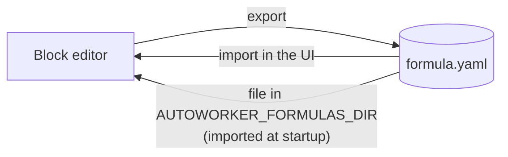
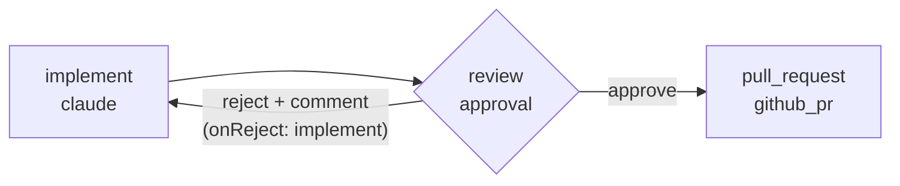

# Formula reference

A formula is the portable form of a workflow: one YAML file that contains
everything needed to recreate it on a fresh deployment. The web editor and the
formula are two views of the same data. Import a formula and it appears as
blocks; build blocks and export them as a formula.



Importing a formula whose name already exists updates that workflow.

A complete example: [`examples/clickup-to-pr.formula.yaml`](../examples/clickup-to-pr.formula.yaml).

## Structure

```yaml
apiVersion: autoworker/v1
kind: Formula
metadata:
  name: My workflow          # required, identifies the workflow on import
  description: What it does
  enabled: true              # disabled workflows ignore their trigger

trigger:                     # what starts a run
  type: clickup
  with: { mode: poll }

environment:                 # what the workflow needs around it
  runtimes: [{ name: node, version: "22" }]
  mcpServers: {}
  memory: [{ path: CLAUDE.md, content: "..." }]
  env: { CI: "true" }
  secrets: [CLAUDE_CODE_OAUTH_TOKEN]
  mounts: []

notifications:               # webhook calls
  - name: phone
    url: "https://ntfy.sh/{{secrets.NTFY_TOPIC | url}}"
    body: "{{message}}"

steps:                       # the blocks, in order
  - id: implement
    type: claude
    name: Implement the task
    with: { prompt: "..." }
```

## Templates

Text settings may contain `{{ path }}` placeholders.

| Placeholder | Value |
|-------------|-------|
| `{{trigger...}}` | The trigger payload, e.g. `{{trigger.task.name}}` for ClickUp |
| `{{steps.<id>.output...}}` | Output of an earlier block, e.g. `{{steps.implement.output.result}}` |
| `{{run.id}}` | Id of the run |
| `{{repo.branch}}`, `{{repo.baseBranch}}`, `{{repo.owner}}`, `{{repo.name}}` | Set by the clone block |

Unknown placeholders render as empty text.

Filters prepare a value for where it is used:

- `{{ message | json }}` renders a JSON literal, with quotes and escaping. Use it inside JSON bodies.
- `{{ message | url }}` percent-encodes the value. Use it inside URLs.

## Triggers

| Type | Starts a run when | Payload |
|------|-------------------|---------|
| `manual` | You press **Run now** | Whatever you send to `POST /api/workflows/:id/run` |
| `webhook` | `POST /hooks/<workflow id>?secret=<hook secret>` is called | The JSON body |
| `clickup` | A ClickUp task is assigned to you | `task.id`, `task.name`, `task.description`, `task.url`, `task.status` |

ClickUp settings (`with`):

| Key | Default | Meaning |
|-----|---------|---------|
| `mode` | `poll` | `poll` asks ClickUp at an interval and needs no inbound access. `webhook` expects ClickUp to call `/hooks/<workflow id>` |
| `tokenSecret` | `CLICKUP_TOKEN` | Secret holding your ClickUp API token |
| `assigneeId` | owner of the token | Whose assignments to watch |
| `teamId` | first workspace of the token | ClickUp workspace |
| `pollSeconds` | `60` | Poll interval, at least 15 |
| `includeExisting` | `false` | Also run for tasks that were assigned before the workflow was enabled |
| `webhookSecret` | `CLICKUP_WEBHOOK_SECRET` | Secret holding the signing secret ClickUp returned for the webhook |

A task starts a run at most once per workflow.

## Environment

| Key | Meaning |
|-----|---------|
| `runtimes` | Language runtimes, installed with [mise](https://mise.jdx.dev) before the first block runs. `name` and `version` as mise understands them |
| `mcpServers` | MCP servers for Claude, in the format of the `mcpServers` object of a `.mcp.json` file. Use `${NAME}` to refer to environment variables and exposed secrets |
| `memory` | Files for Claude's config directory, usually `CLAUDE.md`. They are written when the workflow is saved or imported. An export contains the files as they are on disk at that moment, so what Claude has learned travels with the formula |
| `env` | Plain environment variables for Claude, commands and the web shell |
| `secrets` | Names of stored secrets that are exposed as environment variables. Values are never part of a formula. After importing on a new deployment, add the values under Settings |
| `mounts` | Volume mounts the workflow expects (`source`, `target`, `readOnly`). Mounts are created when the container starts, so this list documents the requirement and the UI shows which targets are missing |

## Notifications

Each entry is a webhook call.

| Key | Default | Meaning |
|-----|---------|---------|
| `name` | `webhook_<n>` | Lets a notify block address one webhook |
| `url` | required | Template |
| `method` | `POST` | HTTP method |
| `headers` | `{}` | Header values are templates. `Content-Type` defaults to `application/json` |
| `body` | title, message and run URL as JSON | Template |

In addition to the placeholders above, notifications can use:

| Placeholder | Value |
|-------------|-------|
| `{{title}}`, `{{message}}` | What is being announced |
| `{{run.url}}`, `{{run.status}}` | Link to the run (needs `AUTOWORKER_PUBLIC_URL`) and its status |
| `{{workflow.name}}` | Name of the workflow |
| `{{secrets.NAME}}` | A stored secret, so tokens stay out of the formula |

Webhooks are called by notify blocks, and automatically when a run needs your
approval or fails. A failing webhook never fails a run.

Examples:

```yaml
notifications:
  # Slack incoming webhook; the whole URL is a secret.
  - name: slack
    url: "{{secrets.SLACK_WEBHOOK_URL}}"
    body: '{"text": {{message | json}}}'

  # Telegram bot, with values in the URL.
  - name: telegram
    method: GET
    url: "https://api.telegram.org/bot{{secrets.TELEGRAM_TOKEN}}/sendMessage?chat_id={{secrets.TELEGRAM_CHAT}}&text={{message | url}}"
```

## Blocks

Every block has an `id` (unique, used in templates), a `type`, an optional
`name` and its settings under `with`.

| Type | What it does | Output |
|------|--------------|--------|
| `notify` | Calls the notification webhooks. `message`, optional `channel` (webhook name) | `delivered` |
| `clickup_fetch_task` | Loads a ClickUp task. `taskId` | `id`, `name`, `description`, `url`, `status` |
| `git_clone` | Clones a GitHub repository and creates the working branch. `repo` (`owner/name`), `baseBranch`, `branch`, `tokenSecret` | `owner`, `name`, `baseBranch`, `branch` |
| `claude` | Runs Claude Code with a `prompt`. Optional `model`, `permissionMode`, `allowedTools`, `maxTurns`, `continueSession` | `result`, `sessionId`, `costUsd`, `turns` |
| `shell` | Runs a `command` as the agent user, e.g. tests. `continueOnError` | `exitCode`, `passed`, `output` |
| `approval` | Pauses until you approve or reject. `message`, optional `onReject` (id of an earlier block) | `decision`, `comment` |
| `github_pr` | Commits what is left, pushes the branch and opens a pull request as the owner of the token. `title`, `body`, `base`, `draft`, `tokenSecret` | `url`, `number`, `branch` |
| `clickup_comment` | Comments on a ClickUp task. `taskId`, `comment` | `comment` |

### Approval and rework



When an approval with `onReject` is rejected, the run goes back to that block
and the next Claude block receives your comment as its prompt, in the same
conversation. Without `onReject`, rejecting ends the run.
