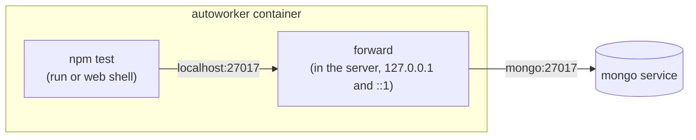
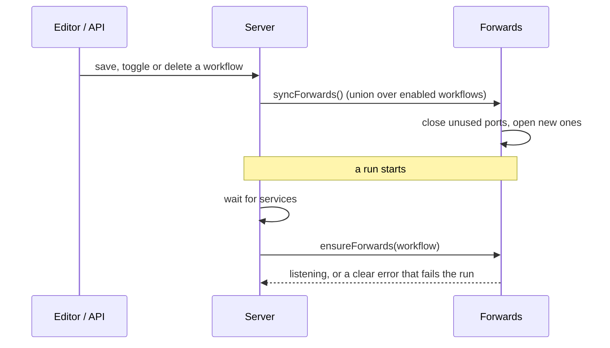

# Localhost forwards for service containers

Service containers are reached by name: a workflow that declares a `mongo`
service talks to `mongo:27017`. Some projects refuse that on purpose. Their
test setup only accepts a loopback URL, for example a Jest `globalSetup` that
rejects any Mongo URL whose host is not `localhost` and falls back to
`mongodb://localhost/app-test`. Nothing listens on `localhost:27017` inside the
Auto Worker container, so those tests cannot connect, and the agent should not
edit the project to work around it.

`forwardToLocalhost: true` on a service fixes this without touching the
project: the server listens on `localhost:<port>` inside the container and
pipes each connection to `<service name>:<port>`.

```yaml
environment:
  services:
    - name: mongo
      image: mongo:8.0.1
      ports: [27017]
      forwardToLocalhost: true   # localhost:27017 -> mongo:27017
```

In the editor it is the "Also on localhost" switch of a service, on the
Environment tab.

## How it works



- The forward is a small TCP proxy inside the server process
  (`server/src/sandbox/forwards.ts`), built on `node:net`. No extra tool, no
  image change and no capability are needed.
- Each accepted connection opens one connection to the service and pipes both
  directions. When either side errors or closes, both sockets are destroyed.
  A failed or reset connection never takes the listener down.
- It listens on the loopback interface only: `127.0.0.1`, plus `::1` when the
  container has IPv6, because `localhost` can resolve to either.

## Container-wide, not per run

Every run and the web shell share one container and one loopback interface.
Two runs could never own `localhost:27017` separately, and the web shell
should see the same forwards as the runs. So forwards are container-wide,
built the same way as the egress allow list:

- The wanted forwards are the union over all **enabled** workflows.
- They are reconciled at startup and whenever a workflow is created, edited,
  restored, imported, enabled, disabled or deleted. Ports no longer wanted are
  closed. A port whose service changed is pointed at the new service.
- Before a run's first block, after waiting for its services, the run checks
  that its own forwards are listening. If one is not, the run fails with a
  message like `Localhost forward not listening: localhost:27017 → mongo:27017
  (port 27017 is already in use inside the container)`.



The trade-off: a workflow that is disabled has no forwards, so a manual run of
a disabled workflow that needs one fails with "forwards are opened for enabled
workflows only". This matches how the egress allow list treats disabled
workflows.

## Rules and conflicts

Checked when a workflow is saved or a formula is imported:

- `forwardToLocalhost` must be `true` or `false`. Left out means `false`, and
  it is only written to an exported formula when it is `true`, so formulas of
  services without a forward stay exactly as they were.
- A forward cannot use the server's own port (`AUTOWORKER_PORT`, 8080).
- Two services of one workflow cannot both forward the same port.

Across workflows a port can only point at one service. Two workflows that
forward `27017` to the same `mongo` service share the forward. If they point
at different services, the first workflow by name gets the port, and the other
is shown as "not listening" with the reason, so its runs fail clearly.

The Environment tab shows each forward next to the service checks:
`localhost:27017 listening`, or `not listening` with the reason.

## Security

- Only the loopback interface is bound, so nothing outside the container can
  use a forward.
- A forward only ever connects to a **declared service** by its name. The
  formula has no field for an arbitrary target host, so a forward cannot be
  used to get around the gateway's allow list. The agent could already reach
  the same service by name; the forward only gives it a second address.
- The compose hardening is unchanged (read-only, `cap_drop: ALL`, internal
  sandbox network). Ports above 1024 need no capability. A port the container
  is not allowed to bind is reported as not listening.
- If a process of the agent user binds the port first, the forward reports
  "already in use" instead of taking it over.
