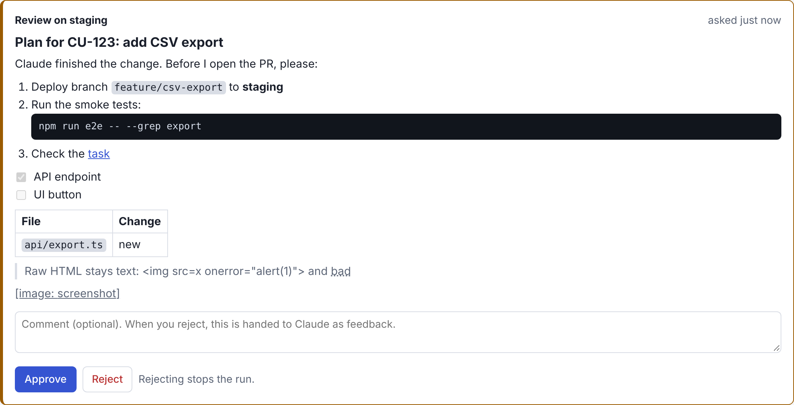
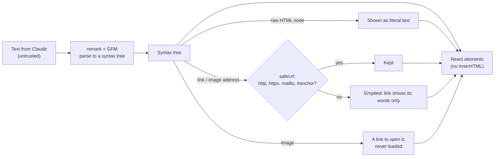

# Claude's messages as Markdown

Claude writes its questions, plans and answers in Markdown: headings, lists,
code blocks, tables, task lists. The web UI renders that text formatted, so
nothing is lost to a wall of asterisks and backticks.



## Where it is rendered

| Place | What |
|-------|------|
| Inbox and the run page, approval cards | The approval message (`message` of a **Wait for approval** block, often filled from Claude's output with `{{steps.<id>.output.text}}`) |
| Pause before a **Run Claude** block | The prompt about to be sent, with a **Preview** / **Edit** switch |
| Run page, **Prompt for this run** | The same switch for the prompt set for this run |
| Run page, activity log | **Claude** messages, **Prompt** entries and **Waiting for you** entries |

Command output, tool calls, tool results and JSON payloads stay as plain,
monospaced text: they are not Markdown, and formatting them would change what
they say.

## Why it is safe

The text is not trusted. It comes from Claude, and Claude in turn read a task,
a web page or a repository that anyone could have written. A ClickUp task with
`` in it must not run script in your browser while you are
signed in to the UI.



- **No HTML strings.** `web/src/components/Markdown.tsx` uses
  [react-markdown](https://github.com/remarkjs/react-markdown), which turns the
  syntax tree straight into React elements. Nothing passes through
  `innerHTML` or `dangerouslySetInnerHTML`, so there is no HTML for a
  sanitizer to miss.
- **Raw HTML is shown, not rendered.** `<script>`, `<iframe>`, event handler
  attributes and every other tag appear as the characters that were written.
- **Only safe link addresses.** `safeUrl` keeps `http:`, `https:` and
  `mailto:` addresses and `#anchors`. `javascript:`, `data:`, `vbscript:`,
  relative paths (which would point at this app's own API) and anything that
  does not parse are emptied; the link's words stay as text. Links open in a
  new tab with `rel="noopener noreferrer nofollow"`.
- **Images are not loaded.** Loading an image tells its server that the page
  was opened, and a prompt injection could put data from the run in the
  address. An image is shown as `[image: alt text]`, a link you can open
  yourself.

- **Code blocks are highlighted without HTML strings.** A fenced block with a
  bundled language (```` ```ts ````, ```` ```json ````, ...) goes through
  `rehype-highlight`, which adds `<span>` elements to the same syntax tree;
  other languages stay plain. No language is guessed. See
  [UI.md](UI.md#syntax-highlighting).

`web/test/markdown.test.ts` renders hostile input (script tags, handler
attributes, `javascript:` in several spellings, `data:` links, tracking
images) and checks none of it reaches the output.

## Changing it

To render Markdown somewhere new, use `<Markdown text={...} />`. To let a
person edit a prompt with a preview, use `<PromptEditor value onChange />`.
Do not add `rehype-raw` or another plugin that lets HTML through, and keep
`urlTransform={safeUrl}`.
