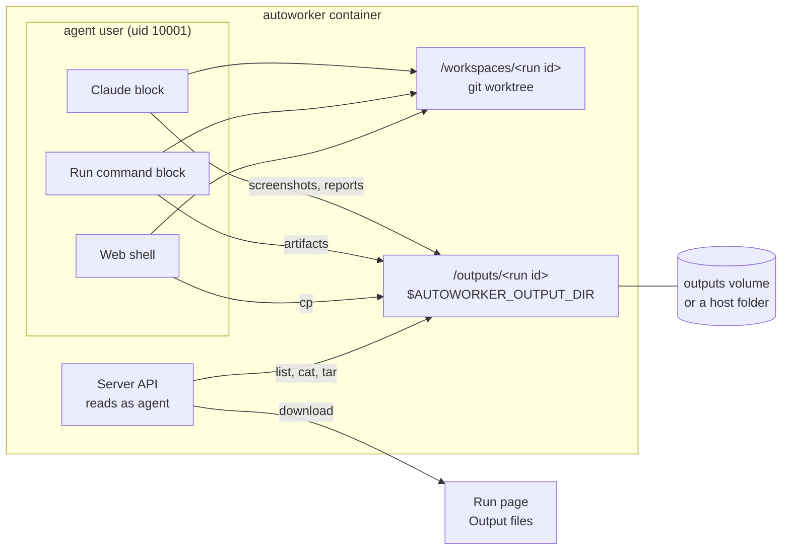
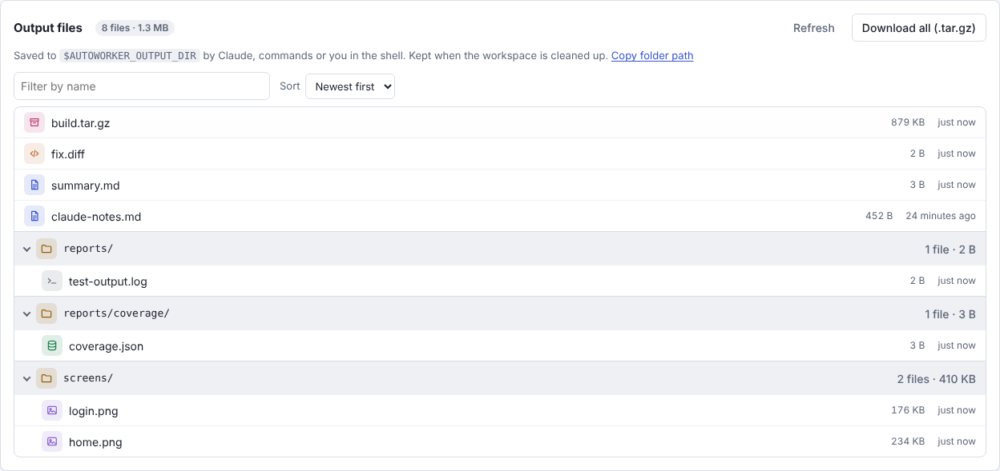

# Output files

Every run has an **output folder** outside the git repository. Claude,
workflow commands and you in the web shell put files there that are meant to
leave the container: screenshots, test reports, logs, exported data, build
artifacts. You download them from the run page.



## Where it is

| | |
|---|---|
| Folder | `/outputs/<run id>` in the container (`AUTOWORKER_OUTPUTS_DIR` sets the parent, default `<data dir>/outputs` in development) |
| Environment variable | `AUTOWORKER_OUTPUT_DIR`, in every command, Claude block and web shell of the run |
| Template | `{{run.outputDir}}`, e.g. in a prompt or a command |
| Volume | `outputs`, mounted at `/outputs` by `compose.yaml` |

The folder is created before the first block runs. It is a sibling of the
workspaces, not part of them, so cleaning up run workspaces never removes the
outputs.

## How Claude learns about it

A **Run Claude** block adds one sentence to Claude's system prompt
(`--append-system-prompt`): files meant for you go in the output folder,
which is outside the repository. Turn off **Tell Claude about the output
folder** on the block (`mentionOutputDir: false` in a formula) to leave it
out. You can also name the folder in the prompt yourself:

```yaml
- id: screenshots
  type: claude
  with:
    prompt: |
      Open the app with Playwright and save a screenshot of every page
      you changed to {{run.outputDir}}/screenshots.
```

A command block uses the variable:

```yaml
- id: report
  type: shell
  with:
    command: npx playwright test --reporter=html && cp -r playwright-report "$AUTOWORKER_OUTPUT_DIR/"
```

## Downloading

The run page has an **Output files** card under the log. It groups the files
by folder (each folder can be folded, with its file count and size), gives
each file an icon by kind (image, document, data, code, archive, log), and
shows size and age. Files that appear while the page is open are marked
*new*. From six files on, a filter box and a sort (newest, name, largest)
appear. It refreshes when a block starts or finishes, has **Download all
(.tar.gz)**, and **Copy folder path** for the path inside the container.
Files only download: none is opened inside the page.



Code in `web/src/run-view/OutputFiles.tsx` and `output-files.ts`, tests in
`web/test/output-files.test.ts`. The same is available over the API:

| Request | Answer |
|---------|--------|
| `GET /api/runs/:id/outputs` | `{ dir, files: [{ path, size, modifiedAt }], truncated }`. At most 1,000 files are listed |
| `GET /api/runs/:id/outputs/file?path=<path>` | The file, as an attachment |
| `GET /api/runs/:id/outputs/archive` | The whole folder as a `.tar.gz` |

To have the files appear on the host without downloading them, replace the
`outputs` volume in `compose.yaml` with a host folder (see
[DEPLOYMENT.md](DEPLOYMENT.md#output-files-on-the-host)).

## Security

The output folder does not widen what the sandbox can reach:

- It is one more folder owned by the agent user, like the workspaces. The
  agent could already write files anywhere in its workspace and home.
- **The server reads it as the agent user.** Listing (`find`), downloading
  (`cat`) and the archive (`tar`) run as uid 10001. A symbolic link Claude
  puts in the folder, say to `/data/autoworker.db`, cannot make the server
  hand out a file the agent could not read itself.
- **Only regular files are served.** The listing does not follow links, and a
  download is only answered for a path that is in the listing, so `..`,
  absolute paths and links are refused with 404. The archive stores links as
  links.
- **Downloads never render as a page of the app.** They are sent as
  `application/octet-stream` attachments with `X-Content-Type-Options:
  nosniff`, so an HTML report from a run cannot run script in the UI's origin.
- Downloads need a signed-in user, like the rest of the API.
- A host folder mounted at `/outputs` is writable by the agent. Use a
  dedicated, empty folder for it and nothing else.

## Formulas

The output folder belongs to the deployment, not to a workflow: every
deployment has it, so a formula does not need to declare it, and imports work
the same everywhere. A Claude block's `mentionOutputDir` setting is part of
the formula like any other block setting.

## Not done yet

- Outputs are kept until you remove them (`docker compose exec autoworker rm -rf /outputs/<run id>`
  or by deleting the volume). There is no retention setting yet.
