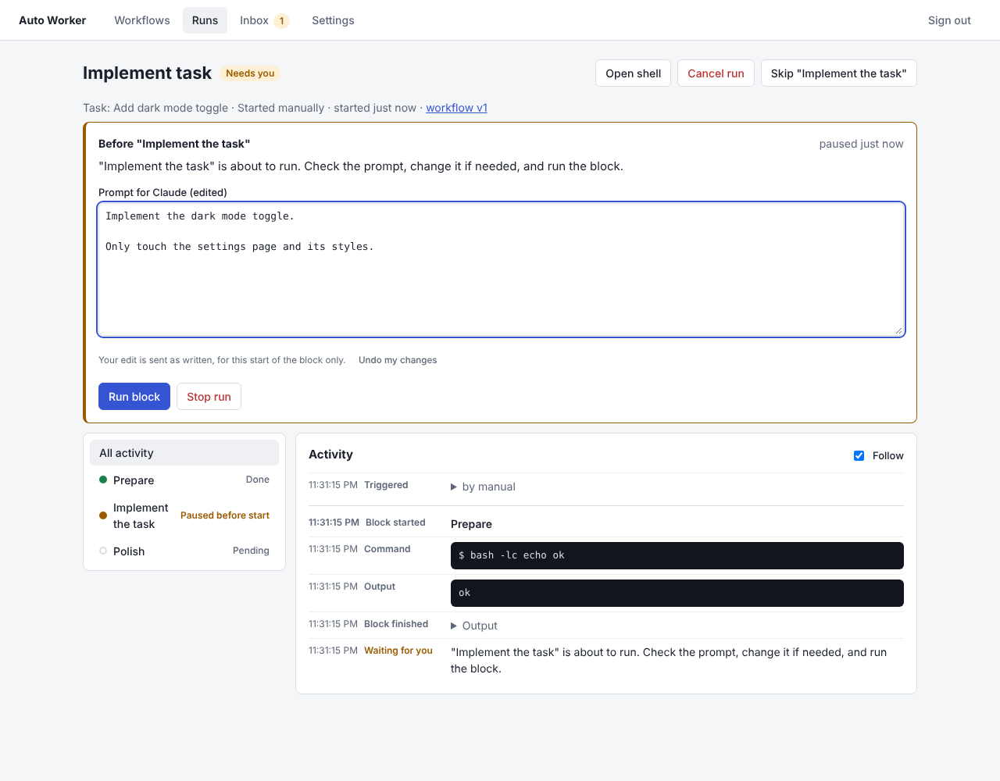
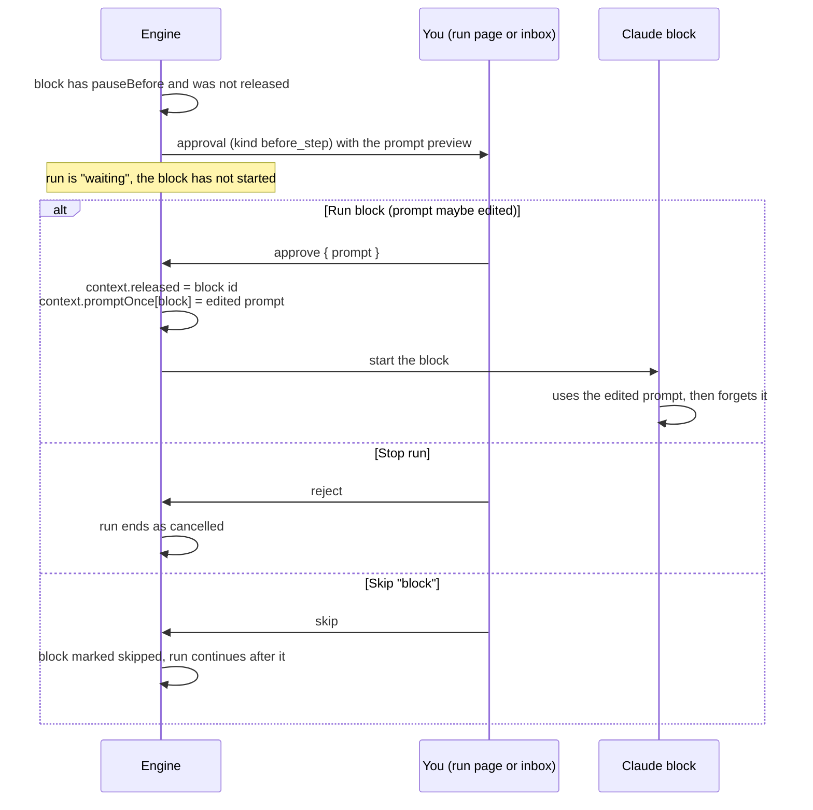
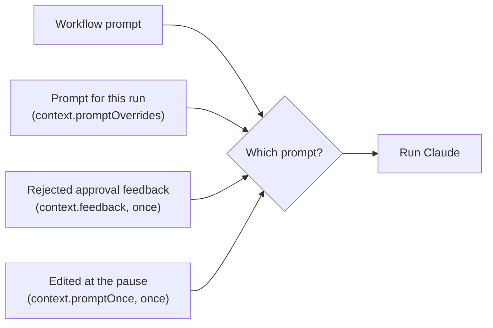

# Pausing before a block and editing Claude's prompt

Two ways to change what Claude is asked, on a run that is already going,
without editing the workflow:

1. **Pause before a block.** Turn on **Pause before this block runs** on any
   block. The run stops right before that block starts and waits for you. On
   a **Run Claude** block the pause shows the prompt it is about to send,
   with every `{{template}}` already filled in, and you can change it before
   you press **Run block**.
2. **Edit the prompt for this run.** On the run page, click a **Run Claude**
   block in the list on the left. **Prompt for this run** lets you replace the
   workflow's prompt for that block, for this run only, at any time while the
   run is open. No pause is needed.



## Pausing before a block



- The pause comes **before** the block starts: the block's `if` is checked
  first (a skipped block never pauses), then the run waits. The block list
  shows **Paused before start**, the inbox lists the pause, and the
  notification webhooks are called as for any approval.
- It pauses **every time** the block is about to start: when a condition or
  a rejected approval sends the run back to it, and when you retry a run that
  failed in it.
- **Run block** starts the block. **Stop run** ends the run as cancelled.
  **Skip** in the page header passes over the block, like for any block.
- Any block can pause before it runs, for example a command that deploys,
  so you can check things in the shell first. Only Claude blocks show a
  prompt to edit.

### The edited prompt

- What you type is sent **as written**: templates were already filled in for
  the preview, and the text is not rendered again.
- It is used **once**, for this start of the block. If the run comes back to
  the block, it pauses again with the prompt it would normally use.
- If you leave the prompt as shown, nothing is recorded and the block runs as
  it would have without the pause.
- When a rejected approval sent the run back, the preview is the feedback
  prompt Claude would get. Editing it replaces the feedback.

## Editing the prompt for this run



The block uses the first of these that is set:

| Order | Prompt | Set by | Kept |
|-------|--------|--------|------|
| 1 | Edited at the pause | **Run block** with a changed prompt | Until the block starts once |
| 2 | Reviewer feedback | Rejecting an approval with "On reject, go back to" | Until the next Claude block starts |
| 3 | Prompt for this run | **Save prompt** on the run page | For the rest of the run, until **Use the workflow prompt** |
| 4 | Workflow prompt | The workflow | Always |

- The prompt for this run is a **template**, like the workflow's:
  `{{trigger.task.name}}` and `{{steps.<id>.output...}}` are filled in when
  the block starts.
- A block that is running keeps the prompt it started with. The change
  applies the next time it starts. A block that already ran uses it only if
  the run comes back to it.
- The workflow itself does not change. To change the prompt for future runs,
  edit the workflow (and apply the edit to open runs if you want, see
  [UI.md](UI.md#applying-a-save-to-open-runs)).
- The run log records each change (**Prompt set for this run**, **Prompt
  edited before run**), and every **Prompt** entry says where its prompt came
  from.

## In a formula

```yaml
steps:
  - id: implement
    type: claude
    name: Implement the task
    pauseBefore: true          # wait for me, and let me edit the prompt
    with:
      prompt: "Implement {{trigger.task.name}}"
```

`pauseBefore` is only written when it is `true`. Prompts edited on a run are
part of that run, never of the formula.

## API

| Route | Purpose |
|-------|---------|
| `POST /api/approvals/:id/resolve` `{ decision: "approved", prompt }` | Run a paused Claude block with this prompt instead of the one shown. `"rejected"` stops the run |
| `PUT /api/runs/:id/prompts/:stepId` `{ prompt }` | Set the prompt a Claude block of this run uses. Returns the run |
| `DELETE /api/runs/:id/prompts/:stepId` | Go back to the workflow's prompt |

Approvals now have a `kind`: `approval` for a **Wait for approval** block,
`before_step` for a pause before a block. `data.prompt` and `data.source`
hold the preview of a Claude block.

## Code

| File | What it does |
|------|--------------|
| `server/src/engine/engine.ts` | `executeStep` pauses (`pauseBefore`), `releaseStep` answers a pause, `setPromptOverride` |
| `server/src/steps/claude.ts` | `resolvePrompt`: which prompt a start of the block uses; `preview` for the pause |
| `server/src/steps/types.ts` | `StepType.preview`: what a block shows when the run pauses before it |
| `web/src/components/ApprovalCard.tsx` | The pause card with the prompt editor |
| `web/src/components/RunPromptCard.tsx` | **Prompt for this run** on the run page |
