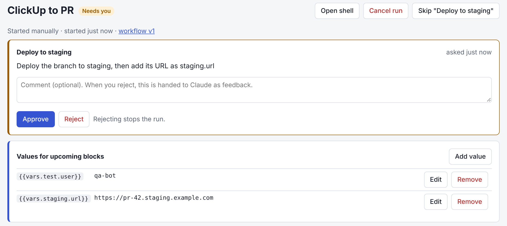
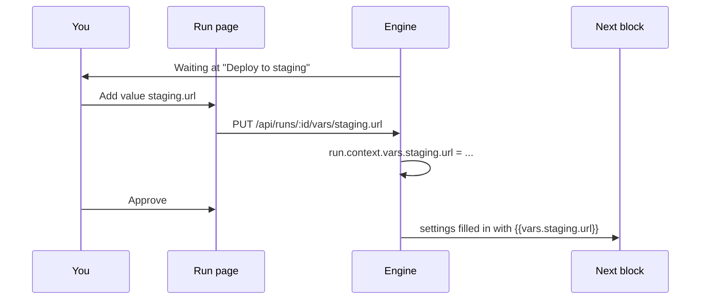

# Values for upcoming blocks

Some things only become known while a run is under way: the URL of the staging
deploy you just made, a test account, a ticket number from another system.
Instead of editing the workflow, you add them to the run from the run page, and
every block that starts afterwards can read them.



## Using a value

A value named `staging.url` is read as:

| Where | How |
|-------|-----|
| Text settings of a block (prompts, commands, messages) | `{{vars.staging.url}}` |
| Conditions and `{{= ... }}` | `vars.staging.url`, e.g. `if: vars.staging.url != null` |

Names are made of letters, digits and `_`, and dots nest: `staging.url` and
`staging.user` both live under `vars.staging`. A value that was never added
reads as empty text in a template and `null` in an expression, so a block can
check for it.

Values are text by default. Tick **Read as JSON** to add a number,
`true`/`false`, a list or an object. A value is at most 64 KB.

## When a value is used



A block's settings are filled in when it starts. So:

| Run is | The value is used by |
|--------|----------------------|
| Waiting for you | The blocks after the approval (or the block the run goes back to on reject) |
| Running | The blocks after the one running now. The running block already has its settings |
| Failed or cancelled | The block that failed, when you **Retry**, and everything after it |
| Succeeded, or its files were [cleaned up](CLEANUP.md) | Nothing. Values can no longer be added or removed |

**Edit** replaces a value, **Remove** deletes it (and the group it was in, if
it was the last one). Every change is in the run's activity log as **Value
added**, **Value changed** or **Value removed**.

Values belong to one run. They are not saved in the workflow or its formula.
For values every run needs, use the workflow's environment variables or
**Run now** inputs instead.

Values appear in the run log and in the settings of the blocks that use them,
so do not add secrets here. Store those under **Settings → Secrets**.

## Example

```yaml
steps:
  - { id: implement, type: claude, with: { prompt: "Implement {{trigger.task.name}}" } }
  - id: deploy
    type: approval
    with: { message: "Deploy the branch to staging, then add its URL as staging.url and approve." }
  - id: e2e
    type: shell
    if: vars.staging.url != null
    with: { command: "npm run e2e -- --base-url {{vars.staging.url}}" }
  - id: fix
    type: claude
    with: { prompt: "The e2e tests against {{vars.staging.url}} printed:\n{{steps.e2e.output.output}}\nFix what failed." }
```

## How it is built

| Piece | File |
|-------|------|
| Name rules, setting and removing nested values | `server/src/run-values.ts` |
| `setRunValue`, `removeRunValue`; `vars` in the scope of every block | `server/src/engine/engine.ts` |
| `PUT /api/runs/:id/vars/:name` (body `{ "value": ... }`), `DELETE /api/runs/:id/vars/:name` | `server/src/http/api.ts` |
| The card on the run page | `web/src/components/RunValuesCard.tsx` |

Values are stored in `run.context.vars`. While a run executes, the engine
holds its own copy of the run in memory and saves it after each block, so a
value added then is written to that copy (kept in `ActiveRun.run`), not to a
separately loaded one that the next save would overwrite.
