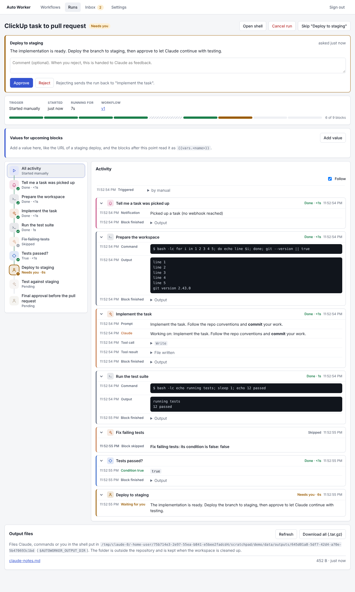
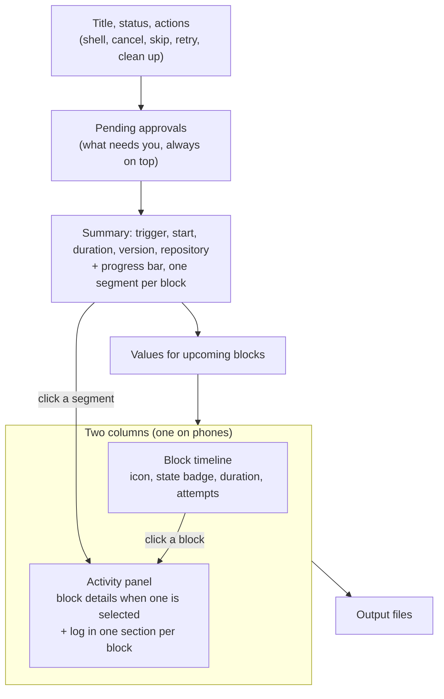
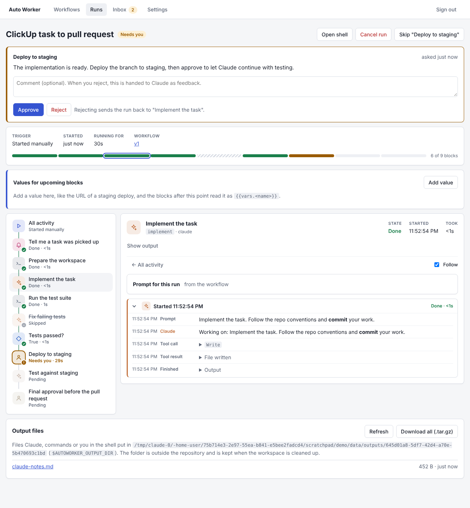
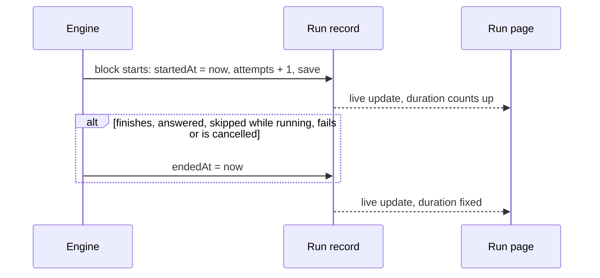

# Run view

The run page shows one run: what needs you, how far it got, every block with its
state and timing, and what each block did. This page explains its layout and
where its data comes from. The features on it (approvals, values, shell, outputs)
are described in [UI.md](UI.md#run-page).



## Layout



- **Summary.** Facts about the run and a progress bar. Each segment is a block,
  coloured like its state (green done, striped skipped, blue running, amber
  needs you, red failed). Clicking a segment selects that block.
- **Block timeline.** The left column lists the blocks top to bottom on a rail
  that turns green up to where the run is. Each block has the icon and colour it
  has on the [flow canvas](FLOW_EDITOR.md), so a block looks the same in the
  editor and in its runs. A badge on the icon gives the state (✓ done, ! needs
  you, ✕ failed, – skipped, a turning ring while running). Under the name: the
  state, how long the block took (counting up while it runs or waits) and the
  attempt when it ran more than once. The first entry, **All activity**, shows
  the whole log.
- **Activity panel.** With **All activity**, the log is split into one section
  per block. A section header has the block's icon, name, state, duration and
  start time; it stays in view while you scroll through a long section, and the
  arrow folds the section away. Clicking the name selects the block. A block
  that runs again (a condition going back, a retry) gets a new section where it
  starts again, so the log keeps its order. Events of the run itself (triggered,
  retried, finished) sit between the sections.
- **One block selected.** The panel starts with the block's details: name, id
  and type, state (or what a condition decided), start time, duration,
  attempts, and **Show output**, the output later blocks read as
  `{{steps.<id>.output}}`. For a **Run Claude** block, **Prompt for this run**
  follows. The log below has one section per attempt.



On screens narrower than 760 px the timeline sits above the activity and
scrolls inside its own box.

## Block timing

Durations come from `run.context.timing`, which the engine keeps per block id:

```ts
interface StepTiming {
  startedAt: string;  // the latest start of the block
  endedAt?: string;   // missing while it runs or waits for a person
  attempts: number;   // how often it started in this run
}
```



- A block that never started (pending, or passed over by a condition) has no
  timing.
- A pause *before* a block (see [PAUSE_BEFORE.md](PAUSE_BEFORE.md)) does not
  start it; the block starts when you let it run.
- Retrying or going back starts a new attempt and overwrites `startedAt`; the
  log keeps the earlier attempts, and their sections show how long they took
  judged by their events.
- Templates cannot read the timing: it is not part of the values blocks see.
- Runs from before this was added have no timing. Their page works the same
  without durations.

## Code

| File | What it does |
|------|--------------|
| `web/src/pages/RunPage.tsx` | Loads the run, holds the selected block, arranges the parts below |
| `web/src/run-view/run-steps.ts` | Pure functions: block state, progress, durations, splitting the log into sections. Tested in `web/test/run-steps.test.ts` |
| `web/src/run-view/RunSummary.tsx` | Facts and the progress bar |
| `web/src/run-view/StepTimeline.tsx` | The block timeline |
| `web/src/run-view/StepDetails.tsx` | Details of the selected block |
| `web/src/run-view/ActivityLog.tsx` | The log in sections, each rendered by `components/EventLog.tsx` |
| `web/src/run-view/use-now.ts` | A clock that ticks every second while the run is open |
| `server/src/engine/engine.ts` | `markStarted` / `markEnded` record `context.timing` |

The log itself stays light as before: it is paged, batched and bounded (see
[UI.md](UI.md#how-the-run-page-stays-light)). Sections are computed from the
events in memory, so a page that starts in the middle of a block still gets a
section for it.
