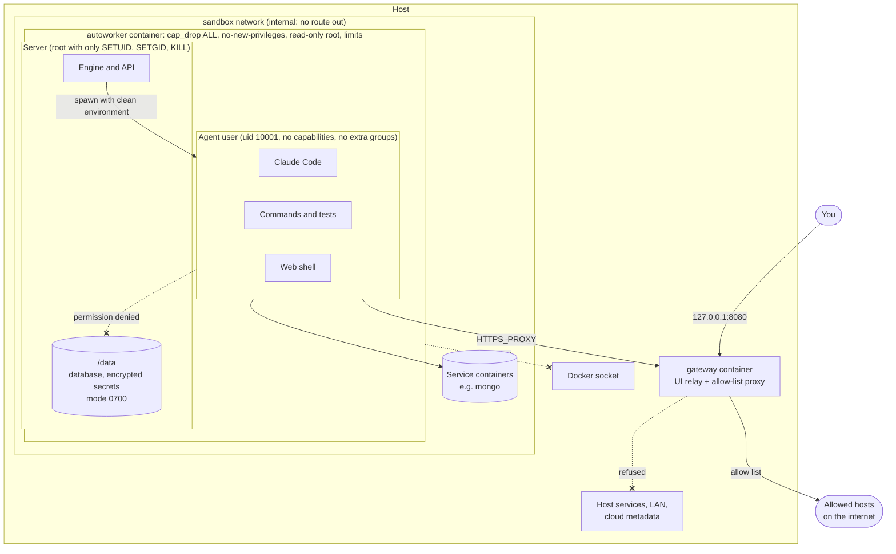
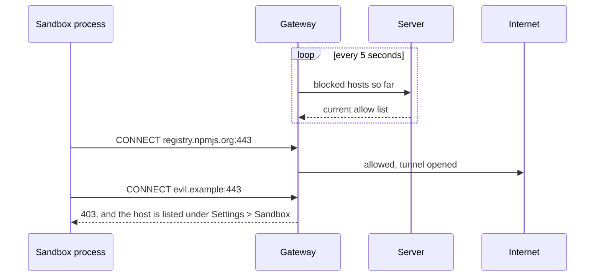

# Security

Auto Worker runs an AI agent that executes arbitrary commands. The design
assumes the agent can be tricked (for example by a malicious task description
or repository) and limits what it can reach when that happens.

## What is protected

| Asset | Threat | Protection |
|-------|--------|------------|
| The host and other containers | The agent breaks out of the container | Hardened container: no capabilities, no new privileges, read-only image, no Docker socket |
| The host's network, the local network, cloud metadata | The agent connects to services it should not see, or sends data anywhere | The sandbox is on an internal network. A gateway only connects to hosts on the allow list |
| The app's own secrets and database | The agent reads tokens or tampers with workflows | The agent is a different, unprivileged user. The database directory is not readable by it. Its environment is built from scratch |
| Your GitHub identity | The agent pushes or opens pull requests on its own | The GitHub token is only handed to the push step, which you gate with an approval block |
| The web UI and shell | Someone else uses them | Token login, HttpOnly SameSite cookie, origin check on the shell WebSocket, port bound to localhost by default |

## Layers



### 1. The container boundary

Set in [`compose.yaml`](../compose.yaml):

| Setting | Effect |
|---------|--------|
| `cap_drop: ALL` plus `SETUID`, `SETGID`, `KILL` | The container cannot mount, load kernel modules, change network settings, trace processes, bypass file permissions or create device nodes. The three remaining capabilities exist only so the server can start and stop processes as the agent user |
| `no-new-privileges` | `sudo`, `su` and any other setuid binary cannot raise privileges |
| `read_only: true` | The image cannot be modified. Only the volumes and `/tmp` are writable |
| No Docker socket, no `privileged`, no host namespaces | There is no path to the Docker daemon or to host processes |
| `internal: true` network | The sandbox has no route to the internet, the host or other compose projects. Only the gateway and the workflow's service containers are reachable. [Localhost forwards](FORWARDS.md) bind only to loopback and only reach declared services |
| `pids_limit`, `mem_limit`, `cpus` | A runaway process cannot exhaust the host |
| Port bound to `127.0.0.1` (on the gateway) | The UI is not exposed to the network unless you put a reverse proxy in front |

Docker's default seccomp and AppArmor profiles stay active. Do not disable them.

### 2. Two users inside the container

The server needs secrets (your tokens, the database). The agent must not get
them. So they are different users:

- The **server** runs as root, but a root that has lost almost all its powers:
  it keeps three capabilities and, for example, cannot read files of other
  users.
- **Claude, workflow commands and the web shell** run as `agent` (uid 10001).
  Switching to this user clears every capability and every extra group, and
  `no-new-privileges` makes that permanent for the process and its children.

Every agent process is started through `server/src/sandbox/agent.ts`, which

1. builds the environment from scratch (formula variables, plus the secrets the formula lists under `environment.secrets`), never from the server's own environment, and
2. sets the agent uid and gid.

### 3. Secrets

- Stored encrypted (AES-256-GCM) with a key derived from `AUTOWORKER_SECRET_KEY`, in a directory only the server user can open.
- The API returns secret names, never values. Formulas contain names only.
- Claude sees only the secrets a workflow explicitly exposes.
- The GitHub token used for clone and push is passed to that single git process through its environment. It is not written to `.git/config` or the remote URL.

### 4. The gateway

The gateway is a second container from the same image, running as an
unprivileged user with no capabilities. It is the only container attached to
a network with a route out, and it does two things
([`server/src/gateway`](../server/src/gateway)):

- **In**: it relays the published port to the app.
- **Out**: it is a forward proxy that connects only to hosts on the allow
  list. The list comes from the `network.allow` section of the enabled
  workflows, plus `AUTOWORKER_EGRESS_ALLOW`.



Rules that hold regardless of the list:

- A host that resolves to a private, loopback or link-local address is
  refused unless it is listed by its exact name. A wildcard never opens the
  host, the local network or a metadata endpoint.
- The server's own calls (ClickUp, GitHub, notification webhooks) present the
  gateway secret and are not restricted. Sandbox processes never see that
  secret.
- Until the gateway has fetched the list for the first time, it allows nothing.

## Verified on every build

CI starts the built image with the hardened compose file and runs
[`docker/smoke-test.mjs`](../docker/smoke-test.mjs), which looks at the
sandbox from the inside. The build fails unless all of these hold:

- workflow commands and the web shell run as uid 10001 with no extra groups
- they have no capabilities, and `NoNewPrivs` is set
- the root file system is read-only
- the server database cannot be read or listed
- no Docker socket is present
- the login token, the secret key and the gateway secret are neither in the agent's environment nor readable through `/proc`
- a direct connection to the internet or to a metadata address fails
- a host that is not on the allow list is refused and reported, and an allowed host is reachable
- runs get a writable output folder outside the workspaces, and a link in it cannot download the database
- the bundled tools are installed

Run it yourself against a running deployment:

```bash
node docker/smoke-test.mjs http://localhost:8080 "$AUTOWORKER_TOKEN"
```

## Known limits and recommendations

Be aware of what the sandbox does not do:

- **The allow list is shared.** The gateway cannot tell runs apart, so every
  sandbox process may reach the hosts of all enabled workflows. Anything on
  the list is also a place data could be sent to, so keep it short.
- **Only proxy-aware traffic gets out.** Programs that ignore the proxy
  variables simply fail to connect. That is the safe direction, but see
  [FORMULA.md](FORMULA.md#network) for Playwright.
- **Without the gateway there is no egress control.** Running the image on
  its own (plain `docker run`, development mode) leaves outbound access open.
  Settings > Sandbox shows whether enforcement is active.
- **Processes of the agent user can see each other.** A background process
  left behind by Claude could read the environment of a later process of the
  same user, including the git process that pushes with your token. Use a
  fine-grained GitHub token limited to the repositories the workflow needs.
- **A container shares the host kernel.** A kernel vulnerability can defeat
  any container. For stronger isolation run Docker in
  [rootless mode](https://docs.docker.com/engine/security/rootless/), enable
  [user namespace remapping](https://docs.docker.com/engine/security/userns-remap/),
  or use a sandboxed runtime such as gVisor (`runtime: runsc`).
- **Whatever you expose to Claude, Claude can use.** Secrets listed in
  `environment.secrets`, mounted volumes and MCP servers are all within its
  reach. Expose the minimum.
- **Claude runs with `bypassPermissions` by default**, because nobody is there
  to answer permission prompts. The sandbox is the control. Tighten
  `permissionMode` or `allowedTools` on a Claude block where you want less.
- **Output files are read as the agent user.** The run page downloads files
  from the run's output folder, but the server lists and reads them as uid
  10001 and only serves regular files, as attachments. A link to the
  database gets a 404. See [OUTPUTS.md](OUTPUTS.md#security).
- **The login token is a single shared credential.** Use a long random value
  and serve the UI over TLS when it leaves localhost.

## Reporting a problem

Please open a private security advisory on the GitHub repository instead of a
public issue.
