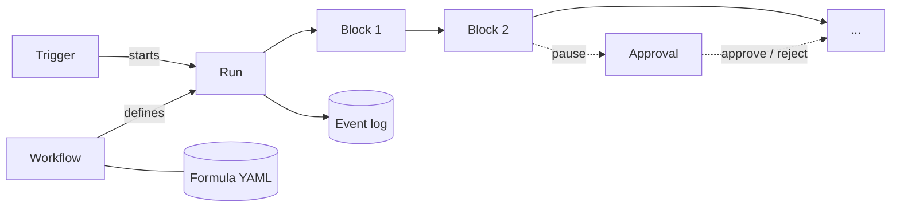
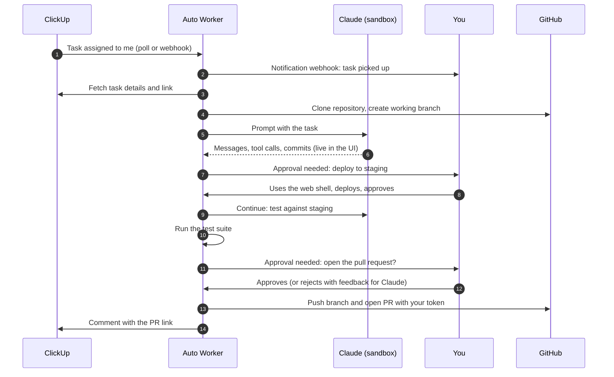

# Specification

Auto Worker is a self-hosted, containerised application that lets Claude Code
work on tasks by itself, inside a sandbox, with a human in control of the
steps that matter.

## Goals

| # | Requirement | How it is met |
|---|-------------|---------------|
| 1 | A container that ships Claude Code and keeps it from reaching the host or other containers | Hardened image, Claude runs as a separate unprivileged user, internal network with an allow-list gateway. See [SECURITY.md](SECURITY.md) |
| 2 | Workflows start from triggers, for example a ClickUp task assigned to me | Trigger types: ClickUp (poll or webhook), generic webhook, manual |
| 3 | Workflows are built from configurable steps, in the UI or in code | Blocks in the web editor, or a YAML formula. Both are the same data, so imported code shows up as blocks |
| 4 | A workflow can be exported and imported again after a redeploy | The **formula**: one YAML file with trigger, blocks, runtimes, MCP servers, Claude memory and skills, service containers, network allow list, environment variables, mounts and notification webhooks |
| 5 | The UI reports what happens | Every run has a live event log: trigger, Claude messages and tool calls, commands, test results, notifications, approvals |
| 6 | Claude can wait for a human | Approval blocks pause the run. Pending approvals appear in the Inbox and trigger a notification |
| 7 | The user can open a shell next to Claude | Web terminal that runs as the same user, in the same workspace, with the same environment |
| 8 | The pull request is opened as the user | The pull request block pushes and opens the PR with the user's own GitHub token, which Claude never sees |
| 9 | Notifications are webhook calls with variables | Notification webhooks live in the formula. URL, headers and body are templates |
| 10 | The sandbox can do what a real development task needs | Toolbelt in the image, plus runtimes, services, skills and network access declared per workflow. See [CAPABILITIES.md](CAPABILITIES.md) |

## Concepts

- **Workflow**: a trigger, an ordered list of blocks, an environment and notification webhooks.
- **Formula**: the portable YAML form of a workflow. See [FORMULA.md](FORMULA.md).
- **Block** (step): one unit of work, such as "Run Claude" or "Wait for approval".
- **Run**: one execution of a workflow, with its own workspace directory and event log.
- **Approval**: a question to the human that pauses a run until it is answered.
- **Secret**: a named, encrypted value. Formulas refer to secrets by name only.

## The reference workflow

The example in [`examples/clickup-to-pr.formula.yaml`](../examples/clickup-to-pr.formula.yaml):

## Milestones

1. **Backend** (this document, engine, blocks, triggers, formulas, API, tests, CI).
2. **Web UI**: block editor, formula import/export, run view, inbox, web shell.
3. **Container**: hardened image, compose file, image build in CI, deployment and security docs.
4. **Formula extensions**: skills, service containers, network allow list with an enforcing gateway, ClickUp comments, subtasks and attachments. See [CAPABILITIES.md](CAPABILITIES.md).
5. **Later**: Claude asking for help in the middle of a step (MCP tool), schedules as a trigger type, automated UI tests.
