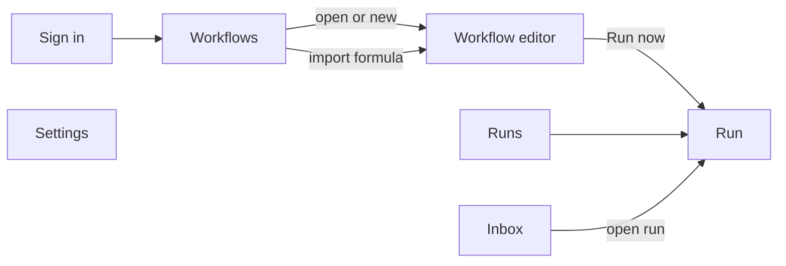
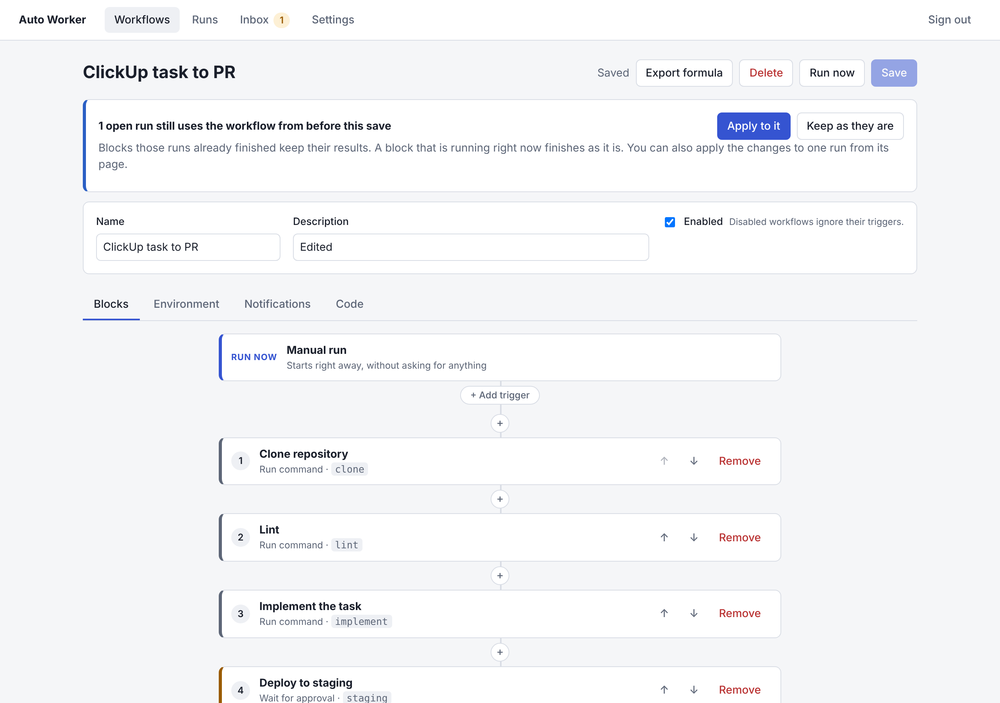
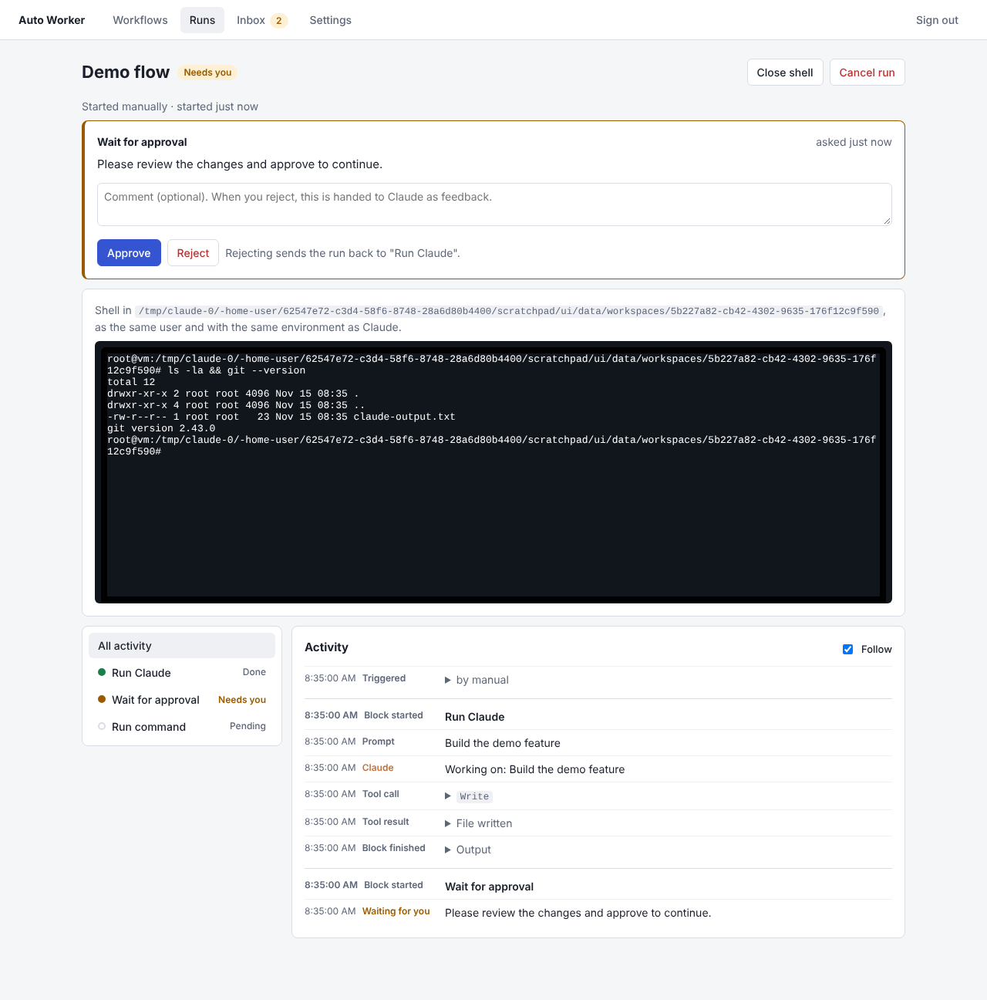
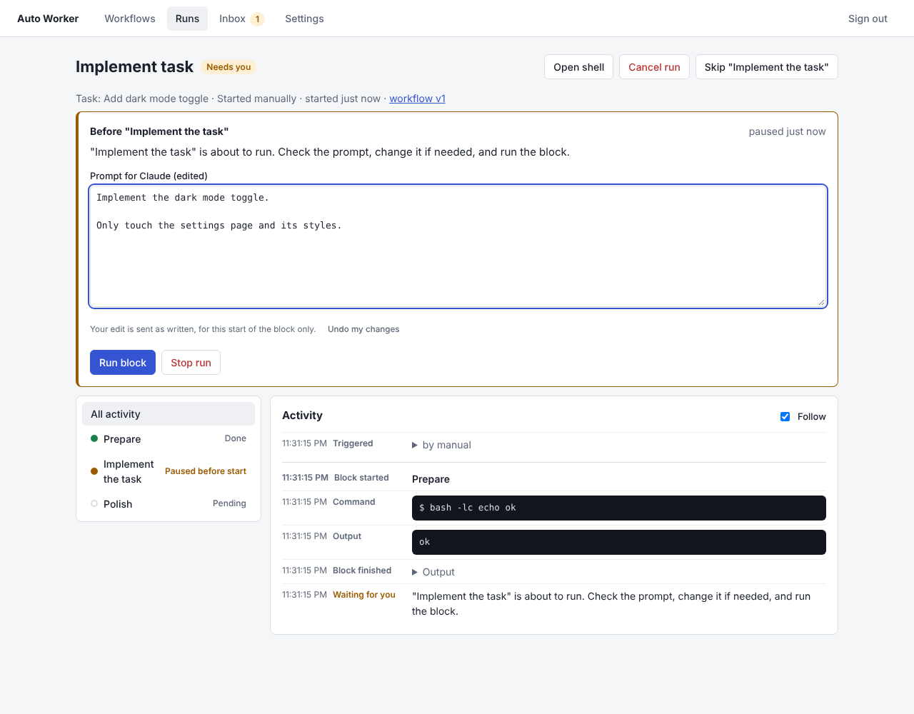
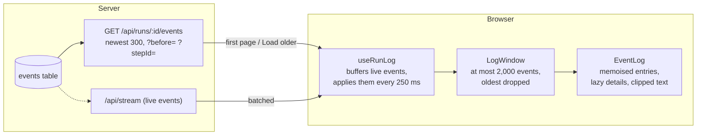

# Web UI

The UI is a single-page React app in `web/`, served by the server. It talks to
the JSON API, receives live updates over server-sent events and opens the web
shell over a WebSocket.

## Pages



| Page | What you do there |
|------|-------------------|
| **Workflows** | See all workflows, import a formula file, start a run |
| **Workflow editor** | Build the workflow. Four tabs edit the same formula; **History** shows its versions |
| **Runs** | History of runs with their state and current block |
| **Run** | Follow a run live, answer its approvals, open a shell, cancel, retry or skip a block |
| **Inbox** | Every approval that is waiting for you, across all runs. The number in the navigation is the count |
| **Settings** | Secrets and the commit author (used for every commit in a run, including the ones Claude makes) |

## Workflow editor


- **Blocks**: the **Run now** block and the triggers on top, then the blocks in
  the order they run. Open the **Run now** block to add inputs: values a manual
  run asks for, see [Run now with inputs](#run-now-with-inputs). Any
  trigger starts a run. **+ Add trigger** adds one, also a second of the same
  type; click a trigger to edit its settings. Triggers that are called from
  outside show their own URL. Without triggers, runs start only from **Run now**.
  Use the `+` between blocks to insert one, drag a block or use the arrows to
  reorder, click a block to edit its settings. Every block has a **Run only
  if** setting, and the **Condition** block branches to another block; both
  show their expression on the block. See [EXPRESSIONS.md](EXPRESSIONS.md).
- **Environment**: runtimes, environment variables, which secrets Claude may
  see, Claude memory files, MCP servers and expected volume mounts.
- **Notifications**: the webhook calls, with templated URL, headers and body.
- **Code**: the formula YAML. Edit and press **Apply to blocks**, and the
  blocks update. This is the same text **Export formula** downloads.
- **History**: every saved version with its note, the line diff of a version
  against the one before (or any other), **Restore this version**, and
  **Export with history**. The title shows the current version, e.g. `v3`.
  When there are unsaved changes, a *What changed?* box next to **Save** takes
  a note for the new version. See [VERSIONING.md](VERSIONING.md).


### Applying a save to open runs

When you save a workflow that has open runs (running, waiting, failed or
cancelled) on the previous version, the editor offers **Apply to them**. It
switches all of them to what you just saved, with the same rules as on the run
page. **Keep as they are** leaves them alone; you can still apply the edits to
one run from its page later.



## Run now with inputs


**Run now**, on the workflow list and in the editor, starts a workflow by
hand. When the workflow declares inputs, a form asks for them first. Fields
marked `*` are required. **Trigger payload** shows the JSON the run will start
with, which is what blocks read as `{{trigger...}}`. The run page lists the
same payload under **Triggered**. Inputs are described in
[FORMULA.md](FORMULA.md#inputs-of-a-manual-run).

## Run page



- The list on the left shows every block and its state. Click one to see only its activity.
  Blocks a condition passed over are marked **Skipped**, and a condition block shows what it decided.
- The activity log updates live: prompts, Claude's messages, tool calls, commands and their output, notifications, approvals.
- A pending approval appears on top. Approve to continue. Reject with a
  comment to send the run back to an earlier block with your comment as
  feedback for Claude, when the block is configured that way.
- A block with **Pause before this block runs** stops the run before it
  starts. On a **Run Claude** block the pause shows the prompt with its
  templates filled in: change it and press **Run block**, or **Stop run**.
  Clicking a **Run Claude** block in the list also shows **Prompt for this
  run**, to replace its prompt for this run at any time. See
  [PAUSE_BEFORE.md](PAUSE_BEFORE.md).

  
- **Skip "block name"** passes over the block the run is at and continues with
  the next one. Use it when a block is stuck or not needed this time. It is
  there while the block runs (what it is doing is stopped), waits for you, or
  has failed. The block is marked **Skipped** and has no output.
- **This workflow was edited after this run started** appears when the
  workflow was saved with changes after the run took its copy, and the run
  has not succeeded. **Review changes** lists each block that differs and
  whether this run will notice: finished blocks keep their results, the block
  the run is at and the ones after it use the new settings. **Apply latest
  workflow** switches the run. A block that is running right now finishes as
  it is first; a failed run picks the changes up when you retry it.

  
- **Retry from failed block** runs the failed block again. A condition block
  that had gone back too often gets its full number of repeats again.
- **Open shell** starts a terminal in the run's workspace, as the same user
  and with the same environment as Claude. Use it to inspect the work or run
  git commands while the run waits for you.
- Long runs show their newest activity first. **Load older activity** at the
  top of the log brings back earlier entries, a page at a time. Very long
  output or tool results show their last (or first) 20,000 characters, with
  **Show earlier** / **Show the rest** for the remainder.

### How the run page stays light

A Claude block can write tens of thousands of lines. Before, the page
downloaded the whole log, added every live line with a full re-render and
refetched the whole log on every change of the run, which froze and could
crash the tab. The page now keeps a bounded window of the log:



| Problem | What the page does now |
|---------|------------------------|
| The whole log was downloaded at once | `GET /api/runs/:id` no longer carries events. The log comes from `GET /api/runs/:id/events`, newest page first; older pages and one block's events on request |
| Each live line re-rendered the whole log | Live events are buffered and applied every 250 ms; entries are memoised and only re-render when they change |
| Every run update refetched everything | Run updates refetch only the run and its approvals, at most one request in flight |
| The log grew forever | At most 2,000 events are kept; the oldest are dropped and can be loaded again |
| Huge outputs and payloads were all in the DOM | Collapsed details are built only when opened; texts over 20,000 characters are clipped. Off-screen entries skip layout (`content-visibility: auto`) |
| Every line of every run was parsed on every page | The shared live connection only parses log events when a page shows a log |

The window logic is in `web/src/run-log.ts` (plain functions, tested in
`web/test/run-log.test.ts`); `web/src/use-run-log.ts` connects it to the API
and the live stream.

## Code structure

| Path | Responsibility |
|------|----------------|
| `web/src/api.ts` | Typed API client. Domain types are imported from `server/src/types.ts` |
| `web/src/live.ts` | One shared server-sent-events connection, `useLive` hook |
| `web/src/router.ts` | Hash router |
| `web/src/App.tsx` | Sign-in gate, navigation, page routing |
| `web/src/pages/` | One file per page |
| `web/src/components/BlockPipeline.tsx` | The block editor |
| `web/src/components/FieldInput.tsx` | Renders one setting from its field description |
| `web/src/components/EventLog.tsx` | Renders run events by type |
| `web/src/run-log.ts`, `web/src/use-run-log.ts` | The run page's bounded, paged, batched view of a run's log |
| `web/src/components/Terminal.tsx` | xterm.js terminal for the web shell |
| `web/src/components/ApplyLatestCard.tsx` | Run page card that previews and applies workflow edits to the run |

The forms of blocks and triggers are generated from the catalogue the server
returns at `GET /api/meta`. Adding a block type on the server needs no UI
change. To give a new event type its own look in the run log, add a case to
`describe` in `EventLog.tsx`.

## Development

```bash
npm run dev        # server on :8080
npm run dev:web    # UI on :5173 with hot reload, proxies /api to the server
```

`npm run build` builds the UI into `web/dist`, which the server serves.
