# Web UI

The UI is a single-page React app in `web/`, served by the server. It talks to
the JSON API, receives live updates over server-sent events and opens the web
shell over a WebSocket.

## Pages

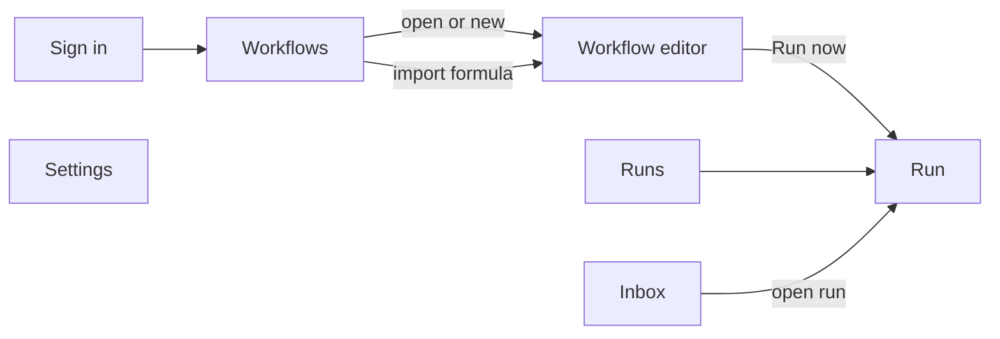

| Page | What you do there |
|------|-------------------|
| **Workflows** | See all workflows, import a formula file, start a run |
| **Workflow editor** | Build the workflow. Four tabs edit the same formula; **History** shows its versions |
| **Runs** | History of runs with their state and current block |
| **Run** | Follow a run live, answer its approvals, open a shell, cancel, retry or skip a block |
| **Inbox** | Every approval that is waiting for you, across all runs. The number in the navigation is the count |
| **Settings** | Secrets and the commit author (used for every commit in a run, including the ones Claude makes) |

## Workflow editor

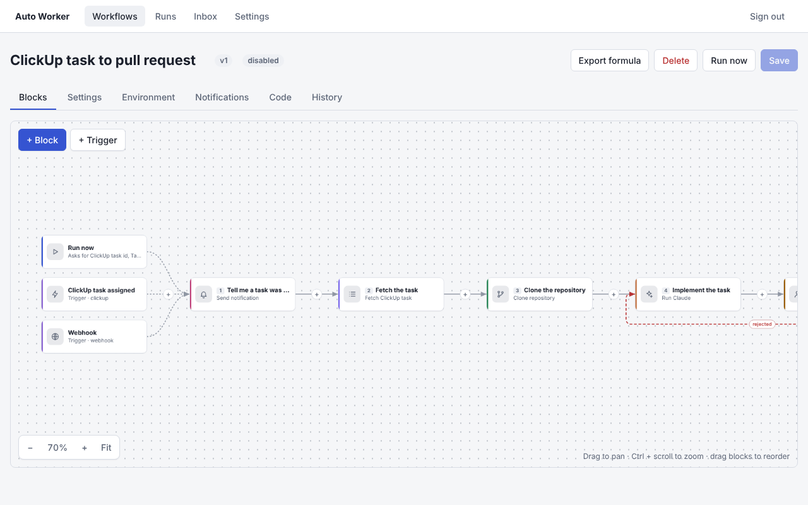

The workflow's name is edited in place in the page title.

- **Blocks**: the workflow as a flow on a canvas, read left to right. **Run
  now** and the triggers start it, then come the blocks in the order they
  run, then the end. Drag the background to pan, Ctrl/⌘ + scroll or pinch to
  zoom, **Fit** to see all of it. Click a node to edit it in the side panel,
  use a `+` between two nodes (or **+ Block**, **+ Trigger**) to add one, drag
  a block sideways to reorder it. Condition outcomes and "go back on
  rejection" are drawn as labelled edges. Everything about the canvas is in
  [FLOW_EDITOR.md](FLOW_EDITOR.md). Open **Run now** to add inputs: values a
  manual run asks for, see [Run now with inputs](#run-now-with-inputs).
  Triggers that are called from outside show their own URL in their panel.
  Without triggers, runs start only from **Run now**. Every block has a
  **Run only if** setting, shown on the node. See [EXPRESSIONS.md](EXPRESSIONS.md).
- **Settings**: description, **Enabled** (disabled workflows ignore their
  triggers, the title then says *disabled*), and **Files of finished runs**.
- **Environment**: runtimes, environment variables, which secrets Claude may
  see, Claude memory files, MCP servers and expected volume mounts. Secrets
  are picked in a search-and-multiselect box: type to filter, Enter or a
  click to pick, × on a chip to remove.

  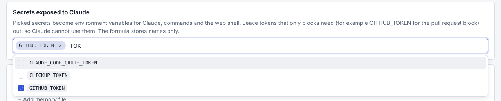
- **Notifications**: the webhook calls, with templated URL, headers and body.
  Under each webhook a **Preview** shows the request as it would go out, with
  example values (see [Notification preview](#notification-preview)).
- **Code**: the formula YAML, syntax highlighted. Edit and press **Apply to
  blocks**, and the blocks update. This is the same text **Export formula**
  downloads.

  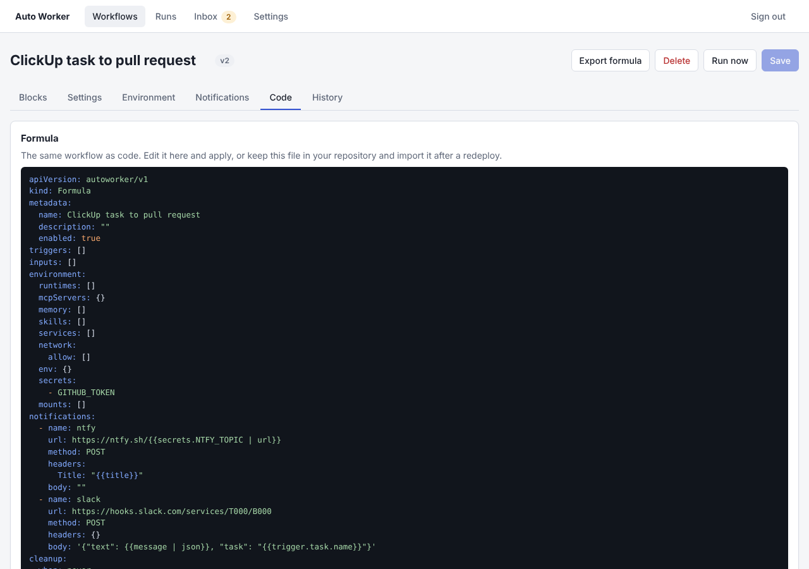
- **History**: every saved version with its note, the line diff of a version
  against the one before (or any other), **Restore this version**, and
  **Export with history**. The title shows the current version, e.g. `v3`.
  When there are unsaved changes, a *What changed?* box next to **Save** takes
  a note for the new version. See [VERSIONING.md](VERSIONING.md).

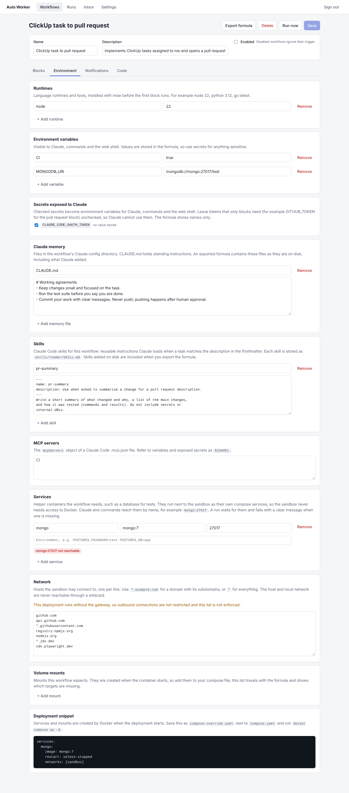

On/off settings (Enabled, Pause before this block runs, Required, read only,
Also on localhost, Read as JSON, Follow) are switches: real checkboxes with
`role="switch"`, drawn as a track and knob in `styles.css`.

### Notification preview

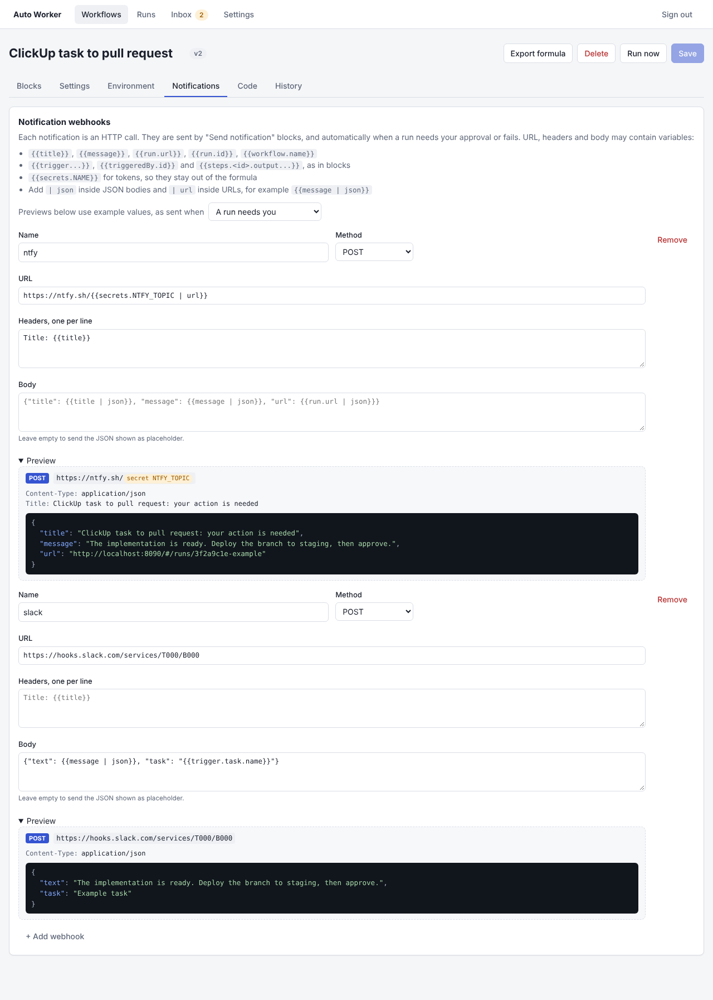

The preview renders each webhook with the server's own code
(`server/src/notify-request.ts`, shared with `notify.ts`), so it shows the
method, URL, headers and body that would really be sent. The select above
the webhooks picks the situation: a run needs you, a run failed, or a
"Send notification" block. Values are examples: a ClickUp-style task, the
workflow's **Run now** inputs (their default, or `<label>`), and a run link
on this page's address. Secrets are never loaded into the page: each
`{{secrets.NAME}}` shows as a *secret NAME* placeholder. A body sent as JSON
that is not valid JSON is flagged, usually a value that is missing `| json`.
Code in `web/src/notifications/`, tests in `web/test/notification-preview.test.ts`.

### Applying a save to open runs

When you save a workflow that has open runs (running, waiting, failed or
cancelled) on the previous version, the editor offers **Apply to them**. It
switches all of them to what you just saved, with the same rules as on the run
page. **Keep as they are** leaves them alone; you can still apply the edits to
one run from its page later.


## Run now with inputs

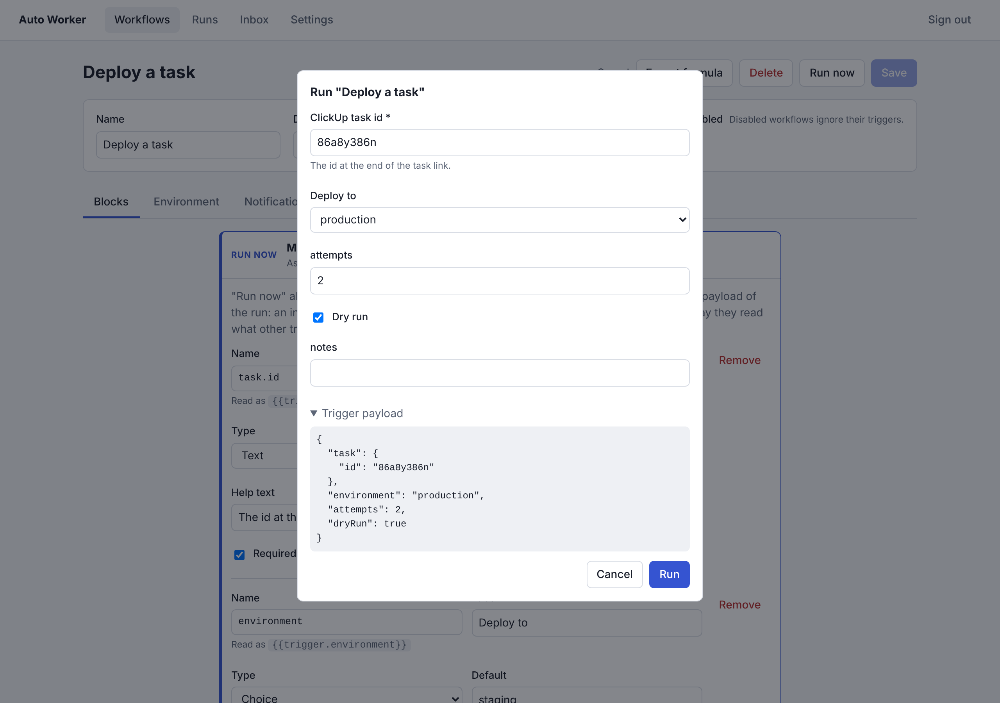

**Run now**, on the workflow list and in the editor, starts a workflow by
hand. When the workflow declares inputs, a form asks for them first. Fields
marked `*` are required. **Trigger payload** shows the JSON the run will start
with, which is what blocks read as `{{trigger...}}`. The run page lists the
same payload under **Triggered**. Inputs are described in
[FORMULA.md](FORMULA.md#inputs-of-a-manual-run).

## Run page

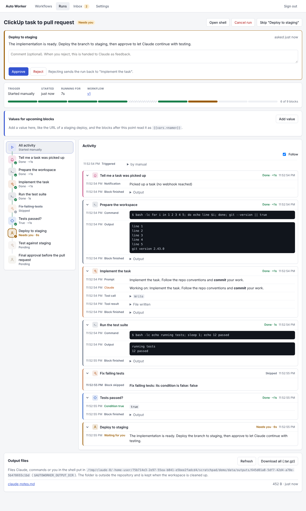

The layout (summary with progress bar, block timeline, activity in one section
per block, block timing) is explained in [RUN_VIEW.md](RUN_VIEW.md).

- The timeline on the left shows every block with its icon, state and how long it took. Click one to see only its activity.
  Blocks a condition passed over are marked **Skipped**, and a condition block shows what it decided.
- The activity log updates live: prompts, Claude's messages, tool calls, commands and their output, notifications, approvals.
  Claude's messages, prompts and approval messages are rendered as Markdown; prompts you can
  edit have a **Preview** / **Edit** switch. See [MARKDOWN.md](MARKDOWN.md).
- A pending approval appears on top. Approve to continue. Reject with a
  comment to send the run back to an earlier block with your comment as
  feedback for Claude, when the block is configured that way.
- A block with **Pause before this block runs** stops the run before it
  starts. On a **Run Claude** block the pause shows the prompt with its
  templates filled in: change it and press **Run block**, or **Stop run**.
  Clicking a **Run Claude** block in the list also shows **Prompt for this
  run**, to replace its prompt for this run at any time. See
  [PAUSE_BEFORE.md](PAUSE_BEFORE.md).

  
- **Values for upcoming blocks** adds values to the run while it is open, such
  as the URL of the staging deploy you just made. Blocks that start afterwards
  read them as `{{vars.<name>}}`. See [RUN-VALUES.md](RUN-VALUES.md).

  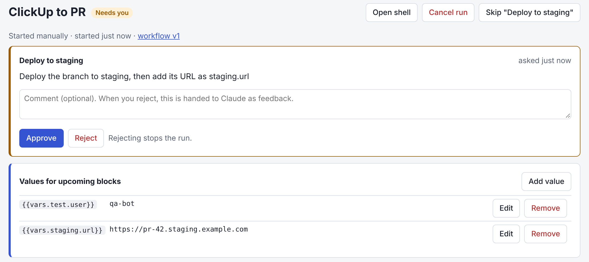
- **Skip "block name"** passes over the block the run is at and continues with
  the next one. Use it when a block is stuck or not needed this time. It is
  there while the block runs (what it is doing is stopped), waits for you, or
  has failed. The block is marked **Skipped** and has no output.
- **This workflow was edited after this run started** appears when the
  workflow was saved with changes after the run took its copy, and the run
  has not succeeded. **Review changes** lists each block that differs and
  whether this run will notice: finished blocks keep their results, the block
  the run is at and the ones after it use the new settings. **Apply latest
  workflow** switches the run. A block that is running right now finishes as
  it is first; a failed run picks the changes up when you retry it.

  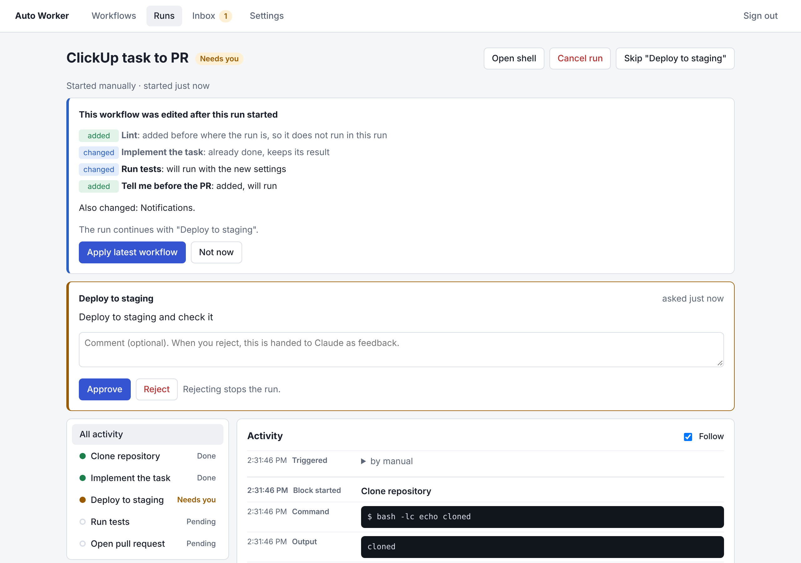
- **Retry from failed block** runs the failed block again. A condition block
  that had gone back too often gets its full number of repeats again.
- **Clean up files** deletes the run's workspace and Claude's conversation
  files once the run has ended. The run and its log stay; it cannot be
  retried afterwards. The Runs page has **Clean up ended runs** for all of
  them at once, and the workflow editor's **Settings** tab has **Files of finished runs** to do
  it automatically. See [CLEANUP.md](CLEANUP.md).
- **Open shell** starts a terminal in the run's workspace, as the same user
  and with the same environment as Claude. Use it to inspect the work or run
  git commands while the run waits for you.
- **Output files** under the log lists what the run put in its output folder
  (`$AUTOWORKER_OUTPUT_DIR`), newest first, with a download link for each and
  **Download all (.tar.gz)**. The folder is outside the repository, so this is
  how screenshots, reports and artifacts get out of the container. See
  [OUTPUTS.md](OUTPUTS.md).
  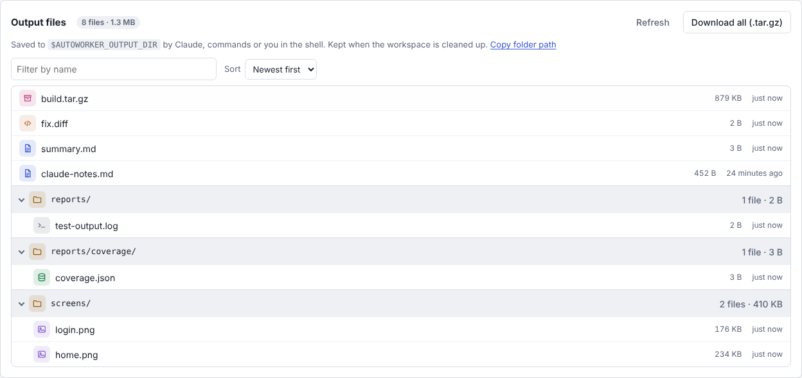
- Long runs show their newest activity first. **Load older activity** at the
  top of the log brings back earlier entries, a page at a time. Very long
  output or tool results show their last (or first) 20,000 characters, with
  **Show earlier** / **Show the rest** for the remainder.

### How the run page stays light

A Claude block can write tens of thousands of lines. Before, the page
downloaded the whole log, added every live line with a full re-render and
refetched the whole log on every change of the run, which froze and could
crash the tab. The page now keeps a bounded window of the log:

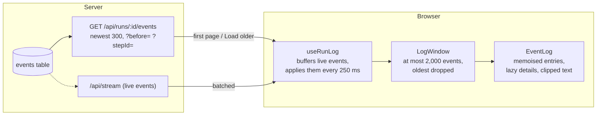

| Problem | What the page does now |
|---------|------------------------|
| The whole log was downloaded at once | `GET /api/runs/:id` no longer carries events. The log comes from `GET /api/runs/:id/events`, newest page first; older pages and one block's events on request |
| Each live line re-rendered the whole log | Live events are buffered and applied every 250 ms; entries are memoised and only re-render when they change |
| Every run update refetched everything | Run updates refetch only the run and its approvals, at most one request in flight |
| The log grew forever | At most 2,000 events are kept; the oldest are dropped and can be loaded again |
| Huge outputs and payloads were all in the DOM | Collapsed details are built only when opened; texts over 20,000 characters are clipped. Off-screen entries skip layout (`content-visibility: auto`) |
| Every line of every run was parsed on every page | The shared live connection only parses log events when a page shows a log |

The window logic is in `web/src/run-log.ts` (plain functions, tested in
`web/test/run-log.test.ts`); `web/src/use-run-log.ts` connects it to the API
and the live stream.

## Layout, overflow and motion

All styles live in `web/src/styles.css`, built on the tokens at its top
(colours, shadows, `--ease`, `--fast`, `--medium`). A few rules keep every page
usable with long content and on small screens:

| Content | What happens |
|---------|--------------|
| Long names, ids, URLs, expressions | Wrap anywhere (`overflow-wrap: anywhere`) instead of widening the page |
| Descriptions in lists | Two lines, the rest on the page they open |
| Logs, command output, code, payloads, errors | Scroll inside their own box with a maximum height |
| Tables and diffs | Scroll sideways inside their card |
| Navigation and tabs | Scroll sideways on narrow screens |
| Run page block timeline | Scrolls inside the sticky sidebar; above the log on phones |

Pages fade in when they open, dialogs pop in, buttons, cards, tabs and inputs
ease between states. Everything is switched off for people whose system asks
for reduced motion. While a page loads its data it shows a spinner
(`Loading` in `components/common.tsx`).

## Code structure

| Path | Responsibility |
|------|----------------|
| `web/src/api.ts` | Typed API client. Domain types are imported from `server/src/types.ts` |
| `web/src/live.ts` | One shared server-sent-events connection, `useLive` hook |
| `web/src/router.ts` | Hash router |
| `web/src/App.tsx` | Sign-in gate, navigation, page routing |
| `web/src/pages/` | One file per page |
| `web/src/flow/` | The flow editor of the Blocks tab, see [FLOW_EDITOR.md](FLOW_EDITOR.md) |
| `web/src/run-view/` | Parts of the run page: summary, block timeline, block details, sectioned log, see [RUN_VIEW.md](RUN_VIEW.md) |
| `web/src/code/highlight.ts`, `components/CodeBlock.tsx`, `components/CodeEditor.tsx` | Syntax highlighting (see below), read-only and editable |
| `web/src/components/MultiSelect.tsx` | Search-and-multiselect box, used for secrets |
| `web/src/notifications/` | Notification preview |
| `web/src/components/FieldInput.tsx` | Renders one setting from its field description |
| `web/src/components/EventLog.tsx` | Renders run events by type |
| `web/src/components/Markdown.tsx` | Renders Claude's text as Markdown, safely (see [MARKDOWN.md](MARKDOWN.md)) |
| `web/src/components/PromptEditor.tsx` | Prompt with Preview / Edit tabs, at pauses and on the run page |
| `web/src/run-log.ts`, `web/src/use-run-log.ts` | The run page's bounded, paged, batched view of a run's log |
| `web/src/components/Terminal.tsx` | xterm.js terminal for the web shell |
| `web/src/components/ApplyLatestCard.tsx` | Run page card that previews and applies workflow edits to the run |

### Syntax highlighting

Code is highlighted with [lowlight](https://github.com/wooorm/lowlight)
(highlight.js grammars) in `web/src/code/highlight.ts`: the formula YAML in the
Code tab, the MCP servers JSON, the compose override, commands (bash), JSON
payloads, tool inputs and block outputs in the run log, and fenced code blocks
with a language in Claude's Markdown (through `rehype-highlight`). Only the
languages listed in `GRAMMARS` are bundled; others, and texts over 50,000
characters, stay plain. lowlight returns a syntax tree that is turned into
React elements, so nothing goes through `innerHTML`. Editable code is a
transparent textarea over a highlighted copy (`CodeEditor.tsx`). Code sits on
the dark code background in both themes, so one set of `.hl-*` colours serves
light and dark.

The forms of blocks and triggers are generated from the catalogue the server
returns at `GET /api/meta`. Adding a block type on the server needs no UI
change. To give a new event type its own look in the run log, add a case to
`describe` in `EventLog.tsx`.

## Development

```bash
npm run dev        # server on :8080
npm run dev:web    # UI on :5173 with hot reload, proxies /api to the server
```

`npm run build` builds the UI into `web/dist`, which the server serves.
