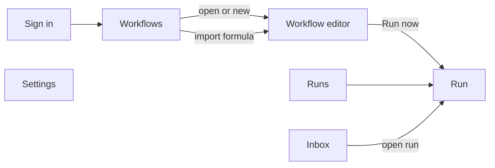

# Web UI

The UI is a single-page React app in `web/`, served by the server. It talks to
the JSON API, receives live updates over server-sent events and opens the web
shell over a WebSocket.

## Pages



| Page | What you do there |
|------|-------------------|
| **Workflows** | See all workflows, import a formula file, start a run |
| **Workflow editor** | Build the workflow. Four tabs, all editing the same formula |
| **Runs** | History of runs with their state and current block |
| **Run** | Follow a run live, answer its approvals, open a shell, cancel or retry |
| **Inbox** | Every approval that is waiting for you, across all runs. The number in the navigation is the count |
| **Settings** | Secrets and the commit author |

## Workflow editor


- **Blocks**: the triggers on top, then the blocks in the order they run. Any
  trigger starts a run. **+ Add trigger** adds one, also a second of the same
  type; click a trigger to edit its settings. Triggers that are called from
  outside show their own URL. Without triggers, runs start only from **Run now**.
  Use the `+` between blocks to insert one, drag a block or use the arrows to
  reorder, click a block to edit its settings. Every block has a **Run only
  if** setting, and the **Condition** block branches to another block; both
  show their expression on the block. See [EXPRESSIONS.md](EXPRESSIONS.md).
- **Environment**: runtimes, environment variables, which secrets Claude may
  see, Claude memory files, MCP servers and expected volume mounts.
- **Notifications**: the webhook calls, with templated URL, headers and body.
- **Code**: the formula YAML. Edit and press **Apply to blocks**, and the
  blocks update. This is the same text **Export formula** downloads.


## Run page


- The list on the left shows every block and its state. Click one to see only its activity.
  Blocks a condition passed over are marked **Skipped**, and a condition block shows what it decided.
- The activity log updates live: prompts, Claude's messages, tool calls, commands and their output, notifications, approvals.
- A pending approval appears on top. Approve to continue. Reject with a
  comment to send the run back to an earlier block with your comment as
  feedback for Claude, when the block is configured that way.
- **Open shell** starts a terminal in the run's workspace, as the same user
  and with the same environment as Claude. Use it to inspect the work or run
  git commands while the run waits for you.

## Code structure

| Path | Responsibility |
|------|----------------|
| `web/src/api.ts` | Typed API client. Domain types are imported from `server/src/types.ts` |
| `web/src/live.ts` | One shared server-sent-events connection, `useLive` hook |
| `web/src/router.ts` | Hash router |
| `web/src/App.tsx` | Sign-in gate, navigation, page routing |
| `web/src/pages/` | One file per page |
| `web/src/components/BlockPipeline.tsx` | The block editor |
| `web/src/components/FieldInput.tsx` | Renders one setting from its field description |
| `web/src/components/EventLog.tsx` | Renders run events by type |
| `web/src/components/Terminal.tsx` | xterm.js terminal for the web shell |

The forms of blocks and triggers are generated from the catalogue the server
returns at `GET /api/meta`. Adding a block type on the server needs no UI
change. To give a new event type its own look in the run log, add a case to
`describe` in `EventLog.tsx`.

## Development

```bash
npm run dev        # server on :8080
npm run dev:web    # UI on :5173 with hot reload, proxies /api to the server
```

`npm run build` builds the UI into `web/dist`, which the server serves.
