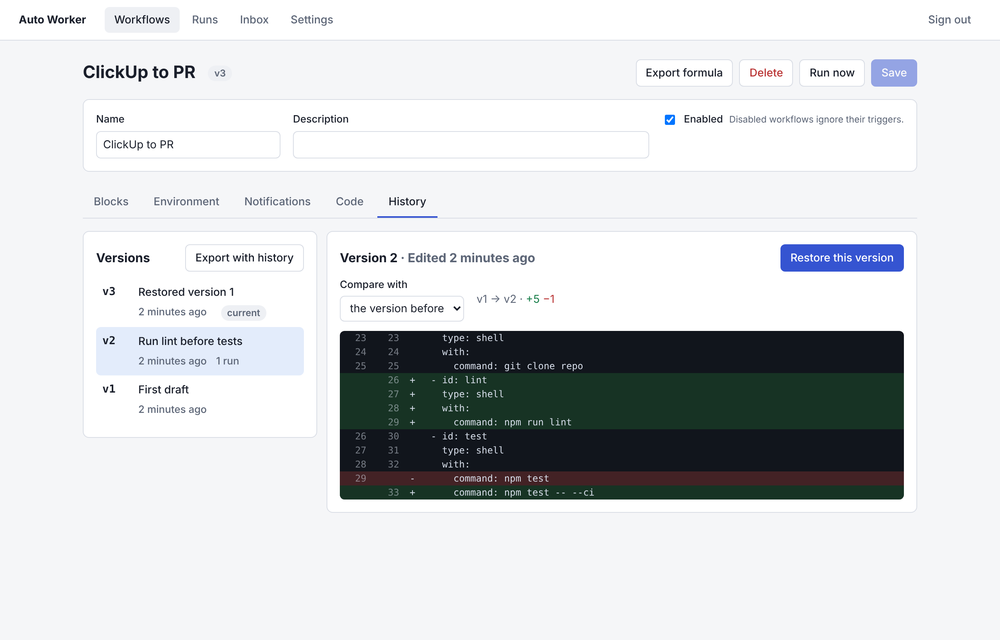
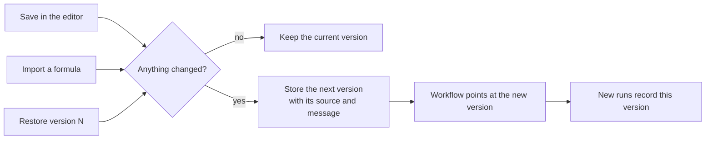
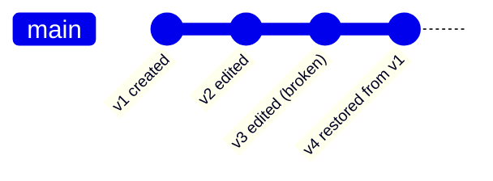

# Workflow versions

Every workflow keeps its history like a git repository keeps commits. Each
save that changes something stores a full copy of the workflow as the next
version. You can see what changed between any two versions, and bring back
any old version with one click.



## How versions are made



| Source | Made by | Message |
|--------|---------|---------|
| `created` | Creating the workflow | What you typed, or empty |
| `edited` | **Save** in the editor (`PUT /api/workflows/:id`) | The optional *What changed?* note next to **Save** |
| `imported` | Importing a formula, also at startup from `formulas/` | `Imported from a formula` |
| `restored` | **Restore this version** on the History tab | `Restored version N` |

A save that changes nothing keeps the current version, so the list only shows
real changes. A version holds the name, description, enabled flag and the full
definition: triggers, inputs, environment, notifications and blocks. The
webhook secret is not part of a version and does not change on restore.

Workflows saved before versions existed get their state at startup as
version 1, with the message *State when version history was turned on*.

## Rollback never rewrites history

Restoring works like `git revert`, not `git reset`: the old content is saved as
a **new** version. Restoring version 1 of a workflow at version 3 makes
version 4, equal to version 1. Version 3 is still there, so a restore can be
undone by restoring version 3.



Restoring also rewrites the Claude memory files of the workflow on disk to the
restored ones and restarts its triggers, exactly like a save.

## Runs and versions

A run copies the workflow definition when it starts, so edits never change a
run that is already going. It also records the version number
(`run.workflowVersion`). The run page shows it as *workflow v3*, and the
History tab counts how many runs each version had. Runs from before versions
existed have no version.

## Comparing versions

The History tab shows a version against the one before it, or against any
version you pick. The comparison is a line diff of the two versions written as
formulas (`server/src/diff.ts`), with three unchanged lines around each change,
like `git diff`.

## Formulas and history

A formula always says which version it was exported from:

```yaml
metadata:
  name: ClickUp to PR
  version: 7          # for people reading the file; an import does not use it
```

**Export with history** (History tab, or `GET /api/workflows/:id/formula?history=true`)
adds every earlier version under `history`, oldest first:

```yaml
history:
  - version: 1
    createdAt: "2026-11-17T14:30:00.000Z"
    source: created
    message: First draft
    name: ClickUp to PR
    description: ""
    enabled: true
    definition:          # triggers, inputs, environment, notifications, steps
      steps: [...]
```

What an import does with it:

- **New workflow** (no workflow with that name yet): the history is recreated
  with its numbers, messages and dates, and the formula itself becomes the
  next version, with source `imported`. So a fresh deployment that imports
  the file at startup keeps the whole history.
- **Existing workflow**: its own history stays as it is. The formula adds one
  version, if it changes anything; the `history` in the file is ignored.

Every entry of `history` is checked like the workflow itself, so an import
fails with a message naming the version if one is not valid.

## API

| Request | What it does |
|---------|--------------|
| `GET /api/workflows/:id/versions` | Versions, newest first, without definitions, with `runs` per version |
| `GET /api/workflows/:id/versions/:n` | One version with its definition |
| `GET /api/workflows/:id/versions/:n/formula` | One version as formula YAML |
| `GET /api/workflows/:id/versions/:n/diff?against=m` | Line diff of version `m` (default `n - 1`) to `n` |
| `POST /api/workflows/:id/versions/:n/restore` | Saves version `n` as a new version. Optional body `{ "message": "..." }` |
| `PUT /api/workflows/:id` | Accepts an optional `message` next to the workflow |

## Where it lives

| Path | Responsibility |
|------|----------------|
| `server/src/store/versions.ts` | The `workflow_versions` table |
| `server/src/store/workflows.ts` | Saving a workflow and its version in one transaction |
| `server/src/diff.ts` | Line diff |
| `server/src/formula.ts` | `metadata.version` and `history` |
| `web/src/components/VersionHistory.tsx` | The History tab |
